# Nanoer Knowledge Base

The technical reference for Nanoer: what it is built on, how each piece works,
which algorithms it uses, and **why** each choice was made. Keep it current:
every new technology, algorithm, design decision, measurement or rejected
alternative gets recorded here (see [§15 Decision log](#15-decision-log)).

Facts marked *(approx.)* are typical published figures that vary with CPU and
data; Nanoer's own measurements are in [§14](#14-measurements).

## Contents

1. [What Nanoer is](#1-what-nanoer-is)
2. [Compression fundamentals](#2-compression-fundamentals)
3. [Codecs](#3-codecs)
4. [Chunking and random access](#4-chunking-and-random-access)
5. [Integrity: checksums and hashes](#5-integrity-checksums-and-hashes)
6. [Deduplication](#6-deduplication)
7. [Storage engine design](#7-storage-engine-design)
8. [Caching: the safe space and read-ahead](#8-caching-the-safe-space-and-read-ahead)
9. [Linux internals Nanoer depends on](#9-linux-internals-nanoer-depends-on)
10. [Existing systems and how Nanoer differs](#10-existing-systems-and-how-nanoer-differs)
11. [Tech stack and reasons](#11-tech-stack-and-reasons)
12. [Testing and verification techniques](#12-testing-and-verification-techniques)
13. [Licensing](#13-licensing)
14. [Measurements](#14-measurements)
15. [Decision log](#15-decision-log)
16. [History: the Python prototype (format v1)](#16-history-the-python-prototype-format-v1)
17. [Glossary](#17-glossary)
18. [References](#18-references)

---

## 1. What Nanoer is

**Goal:** transparent, OS-level compression. With identical contents, a system
that needs **800 GB** without Nanoer should need about **500 GB** with it.
Every program (the OS, apps, games, tools) keeps reading and writing normal
files and never knows the data is compressed.

**Core idea, live extraction:** data is stored as independently compressed
chunks. When a program reads a byte, only the chunk containing it is
decompressed, into a bounded memory budget called the **safe space**. Nothing
is ever fully extracted to disk.

**Roadmap:**

| Stage | What | Where it runs |
|---|---|---|
| 1 | C++ engine + read-write FUSE filesystem (`nanoerfs`) for folders such as `/home`, `/opt`, games | user space |
| 2 | Whole OS: compressed read-only system image + writable Nanoer layer, booted from initramfs | user space + boot |
| 3 | Kernel driver (C or Rust) using the same on-disk format, for full speed | kernel |

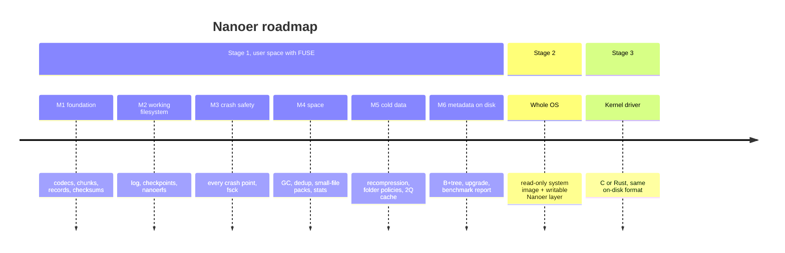

Linux first. Windows and macOS come later.

**Status:** stage 1. Milestones **M1 to M5** are complete: `nanoerfs`
mounts a Nanoer store through FUSE as a normal read-write folder that
survives every power cut, with `fsck`, garbage collection, dedup, packing
of small files and recompression of cold data. **M6** (metadata on disk
in a B+tree, upgrades of older filesystems, the benchmark report) is in
progress: steps 1–3 of 7 are done (2026-10-28).

**Saving 37.5 % of the disk (800 → 500) needs an average compression ratio of
1.6 : 1.** That is realistic for OS files, applications, code and documents
(measured at 42.5 % of original size with fast zstd, 37.2 % with maximum
zstd, see §14) and impossible for already-encoded media
(about 1 : 1). Total savings depend on what is on the disk.

---

## 2. Compression fundamentals

### 2.1 Why data compresses at all

Lossless compression removes **redundancy**. Claude Shannon (1948) showed the
minimum average size of data is set by its **entropy**: the less predictable
the data, the less it can shrink. Two kinds of redundancy matter in practice:

1. **Repetition:** the same byte sequences recur (code, text, binaries,
   uncompressed images). Removed by **dictionary/LZ** methods.
2. **Skewed symbol statistics:** some bytes or tokens are far more common
   than others. Removed by **entropy coding**.

Modern codecs combine both: an LZ stage finds repeats, then an entropy coder
packs what remains.

### 2.2 LZ77 (Lempel & Ziv, 1977)

The encoder slides a **window** over previously seen data. At each position it
looks for the longest earlier match and emits either a **literal** (a raw
byte) or a **(distance, length)** pair: "copy `length` bytes from `distance`
bytes back". A bigger window finds more distant repeats (better ratio) but
needs more memory and search time. Match finders use hash chains or binary
trees. Decompression is just copying, which is why LZ decoders are fast.

### 2.3 Entropy coding

- **Huffman coding (1952):** gives frequent symbols shorter bit codes. Fast,
  but every code is a whole number of bits, which wastes space when one
  symbol is very likely.
- **Arithmetic / range coding:** encodes the whole message as one number in
  an interval, reaching fractions of a bit per symbol. Excellent ratio, but
  slower. Used by LZMA.
- **ANS, Asymmetric Numeral Systems (Jarek Duda, ~2009–2014):** arithmetic-
  coding efficiency at Huffman-like speed. **tANS** (table-based) is
  implemented as **FSE** (Finite State Entropy) by Yann Collet and used in
  zstd. **rANS** is the range variant.
- **Context modeling:** predicts each bit or byte from the bytes before it
  (LZMA does this with Markov-chain contexts). It gives better predictions and
  smaller output, but costs CPU time.

### 2.4 Why encoded media does not compress

H.264/H.265/AV1 video, AAC/MP3/Opus audio and JPEG/PNG/WebP images are
already compressed by codecs specialised for that media. Their output is close
to random (maximum entropy). General-purpose compressors find almost nothing:
we measured an H.264 MP4 at **99.8 %** of its original size (§14). Nanoer
detects such chunks and **stores them raw**, so they cost nothing extra but
save nothing either. Shrinking media requires *re-encoding* with a better
media codec, which is lossy and out of Nanoer's scope.

### 2.5 The three-way trade-off

Every codec trades **ratio** against **compression speed** against
**decompression speed**. For a filesystem, **decompression speed matters most**,
because data is read far more often than it is written. That is why zstd and
LZ4 dominate modern filesystems.

Measured on Linux system files (§14, 2026-10-24): each codec as a point,
right for faster decompression (MB/s ÷ 3,500), up for more space saved
(0 at 45 % saved, 1 at 65 %).

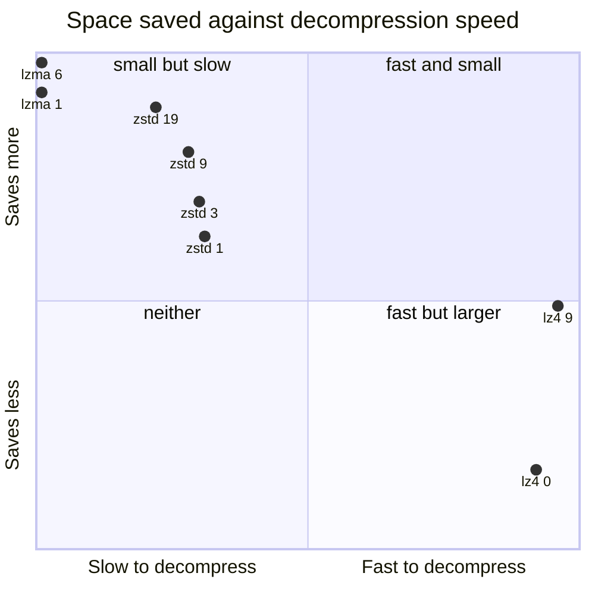

---

## 3. Codecs

Typical single-core figures *(approx.)*. Exact numbers depend heavily on data
and CPU. **Measured on Linux system files with Nanoer's own benchmark: see
§14.**

| Codec | Method | Compress | Decompress | Ratio | Nanoer role |
|---|---|---|---|---|---|
| **LZ4** | LZ77 only, no entropy stage | ~500–800 MB/s | ~3–5 GB/s | lowest | latency-critical data (games, hot files) |
| **zstd** levels 1–3 | LZ77 + Huffman + FSE | ~300–500 MB/s | ~1–1.5 GB/s | good | **default** for written data |
| **zstd** levels 15–19 | same, deeper search | ~5–30 MB/s | ~1–1.5 GB/s | very good | background recompression of cold data |
| **LZMA / xz** | LZ77, large window + range coder + context modeling | ~1–5 MB/s | ~50–150 MB/s | best | archival, rarely read data |
| DEFLATE / zlib | LZ77 (32 KiB window) + Huffman | ~20–60 MB/s | ~300–400 MB/s | moderate | not used (zstd beats it everywhere) |
| none | stored raw | — | memcpy | 1 : 1 | incompressible chunks |

### 3.1 LZ4 (Yann Collet, 2011)

A pure LZ77 byte-oriented format with no entropy coding, so the decoder is
little more than a copy loop. **Why Nanoer uses it:** when a game streams
assets, the slowest step should be the disk, not the CPU. LZ4 adds almost no
latency. Library licence: BSD-2-Clause.

### 3.2 Zstandard / zstd (Yann Collet, Facebook, 1.0 in 2016)

An LZ77 stage feeding Huffman (for literals) and FSE/tANS (for match lengths,
offsets and literal lengths). Key properties:

- **Levels −7 to 22:** higher levels search harder. **Decompression speed
  stays roughly the same at every level**, so data can be written fast now
  and recompressed harder later without slowing reads. This is the basis of
  Nanoer's hot/cold tiering (§7.7).
- **Dictionaries:** a trained dictionary greatly improves the ratio on small,
  similar inputs (config files, small game assets). Planned for small-file
  packing.
- **Long-distance matching (`--long`):** finds repeats far apart in large
  inputs.
- Used by Btrfs, ZFS, squashfs, EROFS, the Linux kernel itself, and package
  formats (Arch, Fedora RPM).

Library licence: BSD **or** GPL-2.0 (dual).

### 3.3 LZMA / xz (Igor Pavlov, 7-Zip)

LZ77 with a very large window (up to 1.5 GiB), plus a range coder driven by
bit-level context models. It has the best ratio of the three, but
decompression is slow (~10× slower than zstd). **Nanoer role:** only for data
that is cold enough that ratio beats read speed. Library: liblzma (XZ Utils),
licence 0BSD in current releases.

> **Security lesson:** XZ Utils 5.6.0 and 5.6.1 shipped a deliberately planted
> backdoor (CVE-2024-3094, found in March 2024). Nanoer pins dependency
> versions, builds them from known sources, and documents each one here.

### 3.4 How Nanoer calls the codecs (M1 implementation)

- **LZ4:** the raw **block** format (`LZ4_compress_default`, or
  `LZ4_compress_HC` for levels 3–12), not the LZ4 frame format. Nanoer's
  record header already stores sizes and checksums, so a frame would only add
  overhead.
- **zstd:** one frame per chunk. Compression and decompression contexts are
  created once **per thread** and reused (`thread_local`), because creating
  a context costs more than compressing a small chunk.
- **LZMA:** an **.xz stream with check type None** (Nanoer has its own
  checksums) holding a single LZMA2 filter. The xz container was chosen
  because the Linux kernel's xz decoder reads it directly (stage 3). The
  LZMA2 **dictionary is shrunk to the chunk size**: liblzma's one-shot API
  otherwise allocates the preset's full dictionary (8 MiB at preset 6) for
  every call, which is pure waste for a 128 KiB chunk. The decoder refuses
  streams needing more than 128 MiB of memory, so damaged data cannot cause
  huge allocations.
- **Null pointers:** an empty buffer may have a null data pointer, and
  liblz4's HC compressor crashes on null even with length 0 (found by
  Nanoer's tests). Nanoer passes a valid dummy address for empty buffers to
  every codec.
- **Kernel availability:** the kernel already contains decoders for LZ4,
  zstd and xz (`lib/lz4`, `lib/zstd`, `lib/xz`). No other codec is used,
  so a stage 3 kernel driver needs no new decompressors.

### 3.5 Incompressibility detection

Compressing data that will not shrink wastes CPU. Strategies, cheapest first:

1. Policy: known-incompressible file types (`.mp4`, `.jpg`, `.zip`, …).
2. A **byte-entropy estimate** on a sample of the chunk (a byte histogram
   gives Shannon entropy; close to 8 bits/byte means random).
3. A fast trial with LZ4 or zstd level 1 on a sample.
4. Always: if the output is not smaller than the input, **store raw**. The
   format records a per-chunk "stored" flag.

Btrfs uses a similar heuristic.

---

## 4. Chunking and random access

A single compressed stream must be decoded from the beginning. Splitting data
into **independently compressed chunks** makes any byte reachable by
decompressing only one chunk. This is the foundation of live extraction.

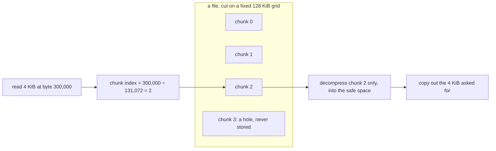

**Chunk size is the central trade-off:**

| Smaller chunks (e.g. 64–128 KiB) | Larger chunks (e.g. 1–16 MiB) |
|---|---|
| fast random reads (little to decompress per read) | slightly better ratio (more context per chunk) |
| cheap rewrites (small read-modify-write) | expensive rewrites: changing 1 byte means recompressing the whole chunk |
| more index entries (more metadata) | less metadata |

**Read amplification:** reading 4 KiB from a 1 MiB chunk decompresses 1 MiB.
**Write amplification:** changing 4 KiB inside a chunk rewrites the whole
compressed chunk.

**Measured (§14):** on Linux system files, 4 MiB chunks compressed only about
1.5 percentage points better than 128 KiB chunks. So, for a writable
filesystem, **moderate chunks (~128 KiB) are the right default**. Larger
chunks are worthwhile only for cold or read-only data (the stage 2 system
image).

**Fixed-size output** (used by EROFS) inverts the usual approach: instead of
compressing fixed-size input, it compresses as much input as fits in a fixed
4 KiB output block, aligning compressed data to disk blocks and reducing read
amplification. Nanoer keeps this as an option for the read-only image.

---

## 5. Integrity: checksums and hashes

Compression amplifies corruption: one flipped bit can destroy a whole chunk.
So every stored chunk is checksummed, and Nanoer **never returns unverified
data**.

| Algorithm | Type | Speed *(approx.)* | Use in Nanoer |
|---|---|---|---|
| **CRC-32C** (Castagnoli) | error-detecting code | many GB/s with the SSE4.2 / ARMv8 CRC instructions | metadata blocks, superblock |
| **XXH3** (xxHash, stable since 0.8.0, 2020) | non-cryptographic hash | tens of GB/s | per-chunk data checksum |
| **BLAKE3** (2020) | cryptographic hash | GB/s, SIMD and multithreaded | deduplication identity |

- **CRC** is designed to catch random bit errors and is hardware-accelerated.
  Btrfs and ext4 (`metadata_csum`) use CRC-32C.
- **XXH3** is far faster than any CRC on large inputs and has good
  distribution, but it is **not** collision-resistant against an attacker.
  That is fine for detecting accidental corruption.
- **BLAKE3** is collision-resistant. Deduplication treats "same hash" as "same
  data", so a weak hash would let a crafted or unlucky collision **silently
  replace one file's contents with another's**. Hence a cryptographic hash.
  Alternative: a weak hash plus byte-for-byte comparison on match, which
  requires reading and decompressing the candidate and is too slow.
- The checksum covers the **uncompressed** data, and verification happens
  after decompression. This catches codec bugs as well as disk errors.
- Every record also carries a **CRC-32C of its stored payload** and one of
  its header. These let scans (log replay, `fsck`, GC) check a record without
  decompressing it, and detect torn writes at the end of the log.

---

## 6. Deduplication

Identical data stored once, referenced many times. Common in OS images
(duplicate libraries, locale files), games (repeated assets), and backups or
VM images.

- **Fixed-size dedup:** hash each fixed chunk and look it up in a hash → chunk
  index. Simple, but inserting one byte shifts every later chunk boundary, so
  nothing matches any more.
- **Content-defined chunking (CDC):** boundaries are chosen by the *content*
  using a rolling hash. A cut happens where the hash of the last few bytes
  matches a pattern, so an insertion only changes nearby chunks.
  - **Rabin fingerprints:** classic rolling hash (used by LBFS, 2001).
  - **Gear hash / FastCDC** (Xia et al., USENIX ATC 2016): much faster
    rolling hash plus "normalized chunking", which keeps chunk sizes near a
    target. This is the modern standard (restic, borg-like tools).
- **Costs:** the dedup index uses RAM or disk (about 32–64 bytes per unique
  chunk). Chunks need **reference counts** so a shared chunk is freed only
  when its last user goes away. Dedup interacts with garbage collection
  (§7.6).

**Nanoer plan:** BLAKE3-identified chunks with reference counts. Fixed-size
chunking for the writable filesystem (writes arrive at arbitrary offsets,
which makes CDC awkward). FastCDC when building read-only images and during
cold-data recompaction.

**As built (M4):**

- **At commit,** every dirty chunk's BLAKE3 is computed in parallel
  *before* compressing, as BLAKE3 (3.8 GB/s per core) is faster than
  compression. A chunk whose content is indexed, confirmed against the
  full BLAKE3 in that record's header, or that appeared earlier in the
  same commit, becomes one more reference ("share", `docs/format.md` §8).
  Only the rest is compressed and written, with the BLAKE3 in its header.
- **The index** maps the first 8 bytes of the BLAKE3 to the record:
  open addressing with linear probing and backward-shift deletion,
  16 bytes an entry, kept between 37.5 % and 75 % full, so 21–43 bytes per
  unique chunk. A target fits one word: offsets are 8-aligned (the flag in
  bit 0) and below 2^48; packs are at most 64 KiB (the piece offset in the
  top 16 bits). The index is part of the in-memory metadata, kept by
  `apply()`: replay and checkpoint loading rebuild it with no extra reads.
  The newest record with a content wins, so GC's copy takes over; an entry
  goes when its record is released (a pack piece: with any reference to
  it, as pieces are not counted one by one). It is derived state, so it is
  not compared when two metadata states are compared.
- **A subtle case, found in review and then proved by a test:**
  duplicates are looked up before the commit's operations are applied, so
  a chunk could be matched to a record that an earlier operation of the
  same commit releases (one file's chunk rewritten while another file takes
  its old content). Each match is confirmed again when it is applied: the
  record must still be indexed, otherwise the chunk is stored after all.
  Chunks are committed in hash-map order, and the first version of the
  test made only the harmless order: it passed even without the fix. It
  now makes both orders, and fails without the fix.
- **Off switches:** `mkfs.nanoer --no-dedup` (a compat preference bit) and
  `-o nodedup`. Filesystems without shared records (M3) never dedup.

How a commit decides, for each dirty chunk:

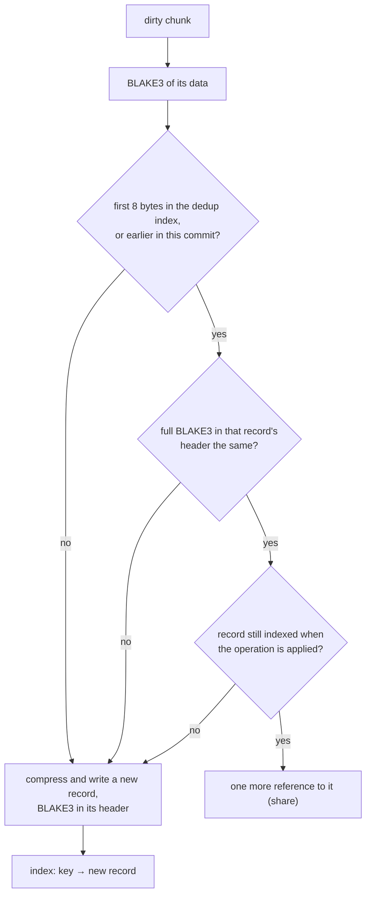

---

## 7. Storage engine design

### 7.0 Nanoer's on-disk format (version 1)

The byte-level specification is `docs/format.md`. Its main design choices:

- **Two superblocks, alternating.** Generation `g` goes to slot `g mod 2`, so
  writing a new superblock never touches the newest valid one. A torn
  superblock write therefore cannot lose the filesystem (tested by simulating
  power cuts mid-write).
- **Never fall back past an unsupported superblock.** If the newest intact
  superblock is from a newer format version, mounting is refused. Using the
  older slot instead would silently throw away newer changes.
- **Feature flags** in three classes, as in ext4: compat (ignore),
  ro_compat (mount read-only), incompat (refuse).
- **Segments carry the filesystem UUID and a sequence number.** A segment
  is in use only if its header names this filesystem. So `mkfs` does not
  need to clear segments, and stays instant even on a 1 TB disk.
- **Records carry their segment's sequence number.** When GC frees a segment
  and the log reuses it, old records left behind beyond the new log's end
  still look intact, but have an older sequence number. The scanner rejects
  them. Without this, stale data could be replayed after a crash.
- **8-byte record alignment.** 4 KiB alignment would waste on average 2 KiB
  per chunk (over 5 % on compressed 128 KiB chunks); 8 bytes keeps integer
  fields aligned at negligible cost.
- **Data starts at 1 MiB** (partition and SSD erase-block alignment, and room
  reserved for future structures). Segment headers are one 4 KiB block.
- **Data chunks record their owner** (inode, file offset), so `fsck` and GC
  can identify a chunk from a segment scan alone.

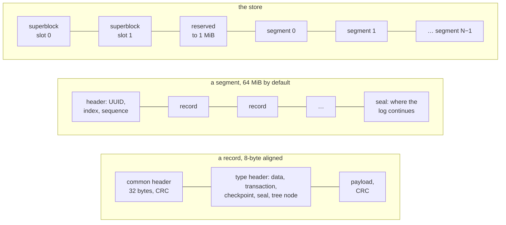

### 7.1 Why not update compressed data in place

Compressed sizes change with content. Rewriting a chunk in place usually does
not fit in the old space, and a crash halfway through corrupts it. Therefore
Nanoer **never overwrites live data**.

### 7.2 Copy-on-write (CoW)

Changes are written to **new** locations, and pointers are then switched
atomically to the new version. The old version stays valid until the switch
completes, so a crash leaves either the old or the new state, never a mix.
Used by ZFS, Btrfs and APFS. CoW also makes **snapshots** cheap: keep the old
pointers.

### 7.3 Log-structured storage

All writes are **appended** to large sequential **segments** (Sprite LFS,
Rosenblum & Ousterhout, 1991; F2FS on flash). Benefits:

- Sequential writes are the fastest pattern on HDDs and SSDs, and the easiest
  on flash wear.
- Natural CoW: nothing is overwritten.
- Crash recovery: replay the log from the last checkpoint.

Cost: space from deleted or overwritten data must be reclaimed by **garbage
collection** (§7.6).

In Nanoer one log runs through the segments in any order, linked by
seals; a reused segment gets a higher sequence number:

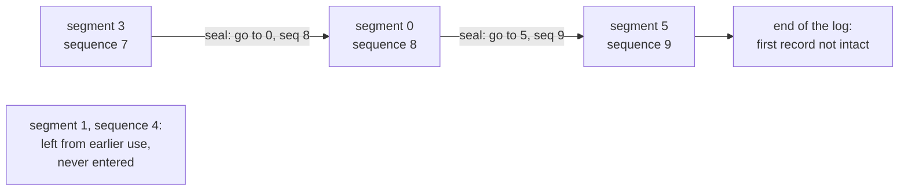

### 7.4 Journaling and write-ahead logging (WAL)

Before metadata changes are applied, a description of them is written to a
**journal** and flushed. After a crash, completed journal entries are
replayed and incomplete ones are discarded (ext4 jbd2, XFS, databases).
Nanoer's log is its journal. A **checkpoint** periodically records a
consistent snapshot of metadata so replay stays short.

### 7.5 Metadata: B+trees

Filesystems need sorted, searchable maps: inode → attributes,
(inode, offset) → chunk location, directory → entries, hash → chunk (dedup).
A **B+tree** keeps keys sorted in wide nodes (one node = one disk block), so
lookups take only a few disk reads even with billions of entries. A
**CoW B+tree** ("shadowing", Ohad Rodeh, 2008, the basis of Btrfs) changes a
leaf by writing a new leaf and new copies of its parents up to a new root,
then atomically switches the root pointer.

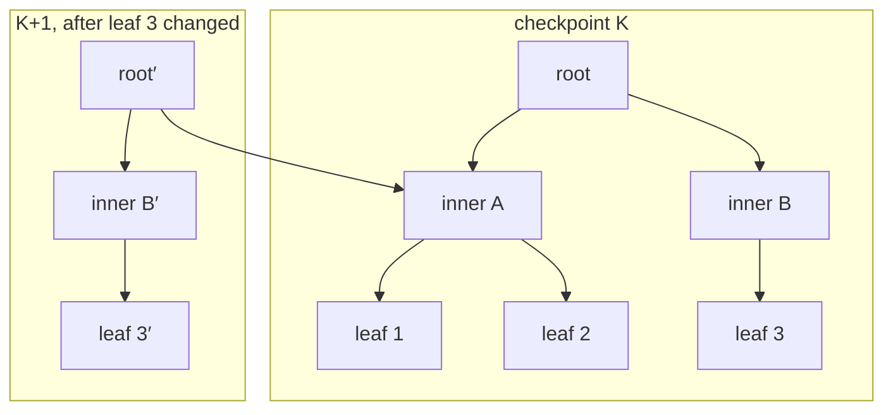

Only the changed leaf and its parents are written again; everything else
is shared, and the old tree stays whole until its space is reused.

**Why not an embedded database?** SQLite (public domain) and LMDB (OpenLDAP
licence) are excellent, but stage 3 needs the same format inside the kernel,
where neither can run. RocksDB (LSM tree, Apache-2.0/GPL-2.0) has the same
problem and adds compaction overhead. Nanoer therefore owns its metadata
format. Stage 1 may start with in-memory metadata plus checkpoints and add the
on-disk B+tree once the rest works (see the stage 1 plan).

**As built (M6 step 1, `src/core/btree.cpp`):** keys of (object, kind,
offset), values of bytes; nodes stored through an interface (`NodeStore`),
so the tree is tested in memory and the filesystem stores nodes in its log.

- **Copy on write:** a change copies the nodes on its path (dirty, in
  memory); `flush()` writes them bottom-up and only then releases the
  nodes they replace, so the previous tree stays whole until then (and on
  disk until its space is reused). An inner node's key for each child is
  that child's first key, which also lets GC find a node from what is
  recorded with it (level and first key) and move it (`relocate`).
- **Splits** by encoded size (16 KiB; a leaf with one large item may be
  larger); **merges** when a node falls below a quarter, else sharing with
  a neighbour. Clean nodes are cached decoded, within a byte budget; a
  released node leaves the cache, as its location may be reused.
- **Tests:** against a `std::map` over 20,000 random operations per seed
  with flushes and reloads, checking after each flush that the live nodes
  are exactly those reachable from the root; old roots readable; exactly
  one node per level rewritten for one change; relocation of every node;
  the cache budget; damaged nodes. Two deliberate bugs (a merge losing an
  item, a flush not releasing what it replaced) were each caught.

**As built (M6 step 2): the filesystem's metadata on the tree**
(`src/core/metadata.cpp`, format: `docs/format.md` §9.2).

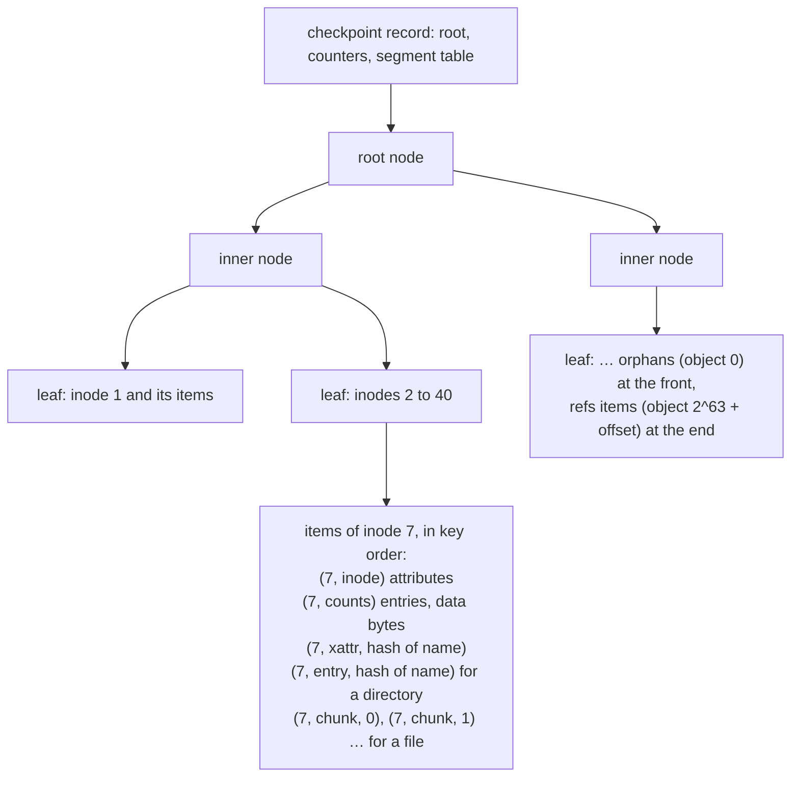

- **Items.** Every inode, directory entry, chunk reference and xattr is
  an item; an inode's items share its number as `object`, so one scan
  reads a file's chunks or a directory's entries in order. Entries and
  xattrs are filed by XXH3-64 of the name (names that collide share one
  item), so a lookup is one key. A *counts* item per inode keeps what used
  to be computed from the in-memory maps (entries in a directory, data
  bytes in a file); *orphan* items list unlinked inodes still open; global
  counters (files, directories, logical bytes, node bytes) live in the
  checkpoint, so statistics need no walk.
- **Back-references.** GC finds records by scanning segments and must
  learn who uses each. A record with one user names it in its header
  (inode, file offset), as since M1; only packs and shared records get a
  *refs* item listing their users. The catch: when a dedup share makes a
  plain record shared, its header names the original writer, which may
  since have moved on, so the share carries the record's current user
  (the reference flag `owner`), and the refs item then stays as long as
  the record is used, even down to one user (*sticky*): that last user need
  not be the one the header names. GC copies of a single-user record
  rewrite the header's owner to its user; tiering does the same for the
  single records it writes.
- **Checkpoints** write the tree's changed nodes (as tree node records,
  zstd 1), then a small record with the root, the counters and the segment
  table: a few hundred bytes, against 122 MiB for 1M files before (§14).
  A checkpoint also comes when changed nodes reach 1/32 of the store
  (256 KiB–32 MiB), so dirty nodes never pile up in memory.
- **Space** of nodes is counted in their segments' live bytes like data;
  a node replaced since the last flush still counts until the flush
  releases it (the previous tree must stay whole until then). `nanoer
  stats` reports nodes separately (`metadata_disk_bytes`); its
  `live_bytes` is data only.
- **The filesystem layer** keeps only attributes it changed since the last
  commit in memory (`attrs_`); everything else is read through the tree
  and its cache (64 MiB).
- **GC** scans each victim's record *headers* (no payloads: faster, and
  enough to find users and nodes). A damaged payload is found when the
  record is read to be copied, and left in place, as before. A damaged
  *header* ends the scan early; since every victim is sealed, a scan that
  does not reach the seal has missed records, so that segment is not
  collected (it would lose them) and the damage is reported. This was a
  bug in the first port, caught by the existing damage test: scanning
  whole records stopped silently at the first bad one. Nodes in a victim
  are marked dirty (`relocate`) and move at the next checkpoint;
  `relocate` says whether it moved a node, found it already moving, or
  not in the tree: only a move is progress (else a victim holding only
  nodes looped forever, caught by the GC tests hanging), and a victim
  whose live bytes are all nodes on their way out counts as emptied
  (else GC's count of emptied segments, which decides when it asks for
  checkpoints, missed them; caught by the TSan run, whose timing put
  nodes in the victims). In the GC churn test (160 MiB rewritten over
  6–7 MiB live), write amplification is 3.0 with the tree, as in M4
  (§14); a figure of 2.1 seen during the port came from the buggy first
  version, which skipped records.
- **The dedup index** is no longer in the checkpoint: it starts empty at
  mount and is filled from the chunk items in the background, 4,096 items
  per step under the shared lock, inserted under the exclusive lock only if
  the chunk is unchanged, in 200 ms slices per background tick. It has a
  memory limit (128 MiB, ≈ 5M chunks); beyond it new keys are left out
  (duplicates missed, never wrong). Until it is complete, duplicates of
  older data are missed.
- **`fsck`** loads the whole tree into the in-memory form of M2–M5
  (`to_legacy`) and runs the existing checks on it; a repair writes a new
  tree with everything (`from_legacy`). Memory is proportional to the
  filesystem, offline only. This departs from the plan's risk table (which
  said fsck streams the tree in key order): it keeps every existing check
  and repair working unchanged for now; streaming, if 1M-file
  measurements show it is needed, comes with step 3's tree checks.
- **Damage in the tree (step 3).** A node that cannot be read is
  `TreeDamage`. Replay turns it into a damaged checkpoint, and so does a
  root that cannot be read at mount (it is read then on purpose), so the
  mount falls back to the previous checkpoint as before M6: the root is
  new in every checkpoint, so that always helps for it. Any other node is
  usually shared by both checkpoints (copy on write), so `fsck` walks the
  whole tree of the checkpoint it uses (every record against its node,
  levels, key ranges, no node twice) and, when no checkpoint can be read
  whole, *salvages* the newest: the nodes it can still read are kept, the
  existing checks remove entries to lost inodes and put files without a
  directory in `lost+found`, and the tree is written again. That came out
  of a test: the older path (search the segments for any readable
  checkpoint) found mkfs's empty one, and its log ran into the same
  damaged node, losing almost everything. `fsck` also checks the derived
  items against the files: counts, totals, unlinked inodes,
  back-references (a mismatch is repaired by writing the tree again).
  Tests: `tests/unit/tree_check_test.cpp` (a damaged root, a damaged
  shared leaf, a node whose header disagrees, each derived item wrong).
  Not covered: a node damaged after mount is found when read (`EIO` for
  that operation), not at mount.
- **Streaming `fsck` (step 5, `src/core/check_tree.cpp`).** The first
  `fsck` on the tree (steps 2–3) loaded all of it into the in-memory form
  of M2–M5: about 400 bytes per file and 125 per chunk. Now it reads the
  tree once in key order, so each inode's items arrive together, and keeps
  only a 48-byte record per inode and a 24-byte one per directory entry
  (directory, child, name hash), plus lists of users for packs and shared
  records. What makes that enough: a record without a list of users must
  name its one chunk in its header (the invariant GC already relies on),
  so no table of every record is needed; a record with a dedup identity
  used by a chunk its header does not name is shared and has merely lost
  its list (a derived fix), one without an identity belongs to another
  file (the chunk is dropped). Directories, links, unlinked inodes and
  lost+found are worked out from the two tables: a directory is reachable
  if the chain of entries keeping it leads to `/`, anything else if a
  reachable directory names it. Paths are looked up only for messages.
  Repairs change items in the tree directly; a second read then rebuilds
  everything derived (counts, the unlinked list, lists of users, totals,
  the space of every segment, nodes included), and a checkpoint writes only
  the changed nodes, with no transaction, so a crash before its superblock
  leaves the filesystem as it was. Still in memory: filesystems from
  before the tree (they need an upgrade to be written anyway), salvaging a
  damaged tree, and rebuilding lost superblocks (both rare and explicit).
  Measured (§14): 1M files, 149 MiB against 1,374 MiB, and 2.8× faster.
  Two things the measurement found on the way, fixed for every mount: the
  node cache counted nodes by their encoded size, while decoded they take
  about 2.6× that (a 64 MiB cache held about 170 MiB); it now counts the
  memory. And replay read the rest of the last segment (up to 64 MiB) into
  memory, then copied it, to look for damage beyond the log's end: it now
  reads 1 MiB at a time.
- **Speed of small operations** (step 6): deleting a file cost 8× its M5
  price in the engine (42,000 instructions against 5,200: every lookup
  walks the tree and decodes, where M5 read a hash map), enough to make
  `rm -rf` 21 % slower on a mount. Five changes, each measured with
  callgrind: values are read in place instead of copied; an inode's items
  go with one range erase (`BTree::erase_range`) and no counts are
  rewritten for an inode being deleted; the last 4,096 decoded inodes are
  kept (direct-mapped by number, ≈ 450 KiB, updated with every inode item
  written, emptied when fsck takes the tree); one-byte integers are
  decoded and encoded inline; and a leaf keeps its values end to end in
  one buffer with their end offsets, so removing or inserting an item
  moves bytes instead of a few hundred separate vectors, and copying a
  leaf is two allocations. Deletion now costs 21,000 instructions, file
  creation 17,000 (M5: 8,000). Most of what is left is the list of users
  of a pack, rewritten whole for every piece removed (back-references),
  and the walks themselves.
- **Filesystems from before M6** (no `metadata_tree`) are replayed as
  before into the in-memory form, converted to a tree in memory, and
  mounted read-only until upgraded; their checkpoints stay version 1 or 2.
- **Tests:** the tree metadata against the M2–M5 implementation as an
  oracle (`tests/unit/metadata_test.cpp`): random operations of every
  kind (files, directories, renames, unlinks, orphans, dedup shares,
  packs, xattrs) on both, compared item by item, through checkpoints, with
  512-byte nodes for several levels; back-references checked against the
  chunks; a deliberate bug (truncation keeping one chunk) was caught. All
  earlier tests (crash points, the filesystem model, GC, tiering, fsck)
  run on the new format.

### 7.6 Garbage collection (GC) and compaction

Overwrites and deletes leave **dead** chunks inside segments. GC picks
segments with a low live-data fraction, copies their live chunks into a new
segment, and frees the old one. The selection policy matters: "greedy"
(least live data) versus "cost-benefit" (also weighs data age, from Sprite
LFS). GC must respect dedup reference counts and run when the disk is idle.

**Old filesystems: `nanoer upgrade` (M6 step 4).** A filesystem made by
M2–M5 mounts read-only (with a message); `nanoer upgrade IMAGE` replays it,
writes its metadata as a tree into free segments after its log, reads the
tree back and compares it, and only then writes the superblock that
switches over. It refuses (changing nothing) a filesystem that recorded
damage or whose log is damaged, and one without room (it says how many
segments it needs). M2 and M3 filesystems get shared records and cold data
too.

- **Records whose header names another file.** When dedup shares a record
  and its first user later goes away, the remaining user is not the one
  the header names; M4/M5 did not mind (their metadata was all in memory),
  but GC on the tree finds a single user from the header. Upgrade reads
  each single-user record's header and gives the mismatches a refs item.
  Without it nothing is lost (the record's space still counts, so its
  segment is never freed), but that segment could never be collected:
  a test that disabled this step still passed on content, so the test
  checks the refs items directly.
- **Test images made by the real old builds** (`tests/images`, by
  `make_images.sh` over each build's own FUSE mount, from commits
  `e19be0e` M2, `a44188c` M3, `47cb8aa` M4, `43c5ae1` M5; 145–510 KB each,
  xz): directories, small, multi-chunk, sparse and all-zero files, hard
  links, a symlink, a FIFO, xattrs, a rename and a delete; M4 and M5 also
  dedup copies, packs and the case above; M5 also a `max` folder and cold
  data. Each ends with an fsynced write and `kill -9`, so the upgrade
  replays a log after the checkpoint. A manifest made over the old mount
  (inode numbers, modes, owners, links, sizes, times, content hashes,
  xattrs) must match read-only before, after the upgrade, and after GC and
  recompressing everything (`tests/integration/upgrade.sh`).
- **A crash at every write of each upgrade, every variant** (34–40 images
  per image): each is either the old filesystem, whole, or the upgraded
  one, with the same files, and `fsck`-clean.
- **A bug from M5 found by it:** GC re-pointed a cold reference to data
  without a dedup identity (a `--no-dedup` filesystem, or data from before
  dedup) with SetChunk, which cannot carry the cold flag, so every
  collection after recompressing such data failed. Fixed (SetChunkRef),
  with a test that fails without the fix.

**Giving space back: discard (M6 step 4).** Freed segments used to stay
allocated in the layer below: an image file only grew (3.1 GiB allocated
for 1.5 GiB of data after M5's recompression, §14), and an SSD kept
treating them as live. Now a segment that becomes free is queued, and the
background gives back 16 per second: `fallocate(PUNCH_HOLE)` on an image
file, `BLKDISCARD` on a block device (errors ignored: it is a hint).

- **Safety comes from what "free" already means:** only a segment the log
  could write over at that moment is discarded, so zeroing it loses
  nothing a checkpoint or its fallback needs; one the log takes back is
  dropped from the queue (all under the filesystem's lock).
- **Segments freed just before a crash** are not forgotten: mount already
  reads every segment header, so every free segment whose header is still
  intact is queued. Once discarded its header reads as zeros, so it is not
  queued again.
- **Tests:** the crash workload with GC gives segments back, recorded in
  64 KiB pieces that a power cut may keep or lose one by one; every crash
  point recovers. On a real image file, 9 segments of 1 MiB given back
  took the allocated size from 10.2 MiB to 2.0 MiB. `-o nodiscard` turns it
  off.

A segment's life:

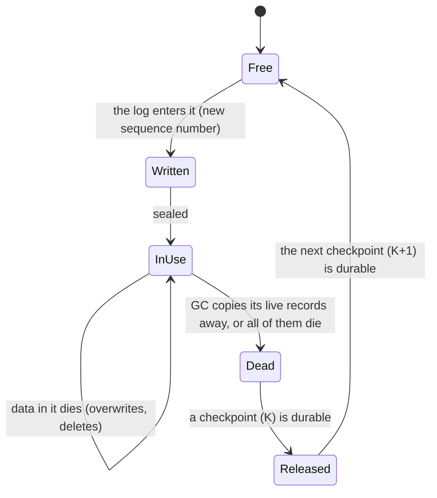

### 7.7 Hot/cold tiering (Nanoer-specific)

Since GC already rewrites data, it can **recompress** it at the same time:

- New writes use a fast codec (zstd level 1–3, or LZ4) to keep write latency
  low.
- When GC moves data that has not been read for a long time (cold), it
  recompresses it with zstd 19 or LZMA and, optionally, larger chunks.
- Because zstd decompresses at the same speed at every level, most cold data
  even reads back as fast as before.

Btrfs and ZFS can only do this through a manual rewrite (defragment or
recompress). Doing it automatically is one of Nanoer's intended advantages.

**As built (M5, `src/core/tier.cpp`; measured in §14):**

- **What is cold:** a regular file whose change time (and mtime, if later)
  is older than `cold_after` (7 days, `-o cold_after=`), with nothing
  uncommitted. Reads do not count: zstd 9 decompresses as fast as zstd 1,
  so data still read often loses nothing, and access times are never
  written. The change time, not mtime, because `tar` and `cp -p` copy
  mtimes: an archive just unpacked would otherwise look years old.
- **What it becomes:** each chunk recompressed **on its own** with zstd 9,
  keeping its header (owner, identity), so it stays in the dedup index.
  Data shared by several files (dedup) is recompressed once and every
  reference re-pointed; it waits until every file using it is cold. A pack
  of small files is packed again with zstd 9. Under the `max` policy the
  cold form is zstd 19 after at most a day; `none` and `fast` never change.
  (The plan grouped chunks into 1 MiB *cold units*; they read too slowly,
  see *The cold unit problem* below.)
- **Every reference to the new record is marked `cold`**, so a pass never
  examines it again. When recompressing does not save at least 3 % (media,
  data already dense), nothing is written: the references are only marked,
  in place, so a video is read once and never rewritten.
- **How:** a pass lists the cold files (and the shared records and packs
  whose users are all cold); steps of 16 MiB then plan (shared lock), read
  and compress on the thread pool (no lock), and re-point what still refers
  to what was read (unique lock), exactly like GC's steps: a file written
  meanwhile keeps its new data. It runs in the background only when the
  filesystem is idle (`-o idle=`, 10 s), at most 2 s at a time, with the
  free segments GC aims for (15 %) to spare, and stops at the first change.
  A new pass starts after a change, or 10 minutes later (files age into
  coldness). `nanoer tier [--age AGE] IMAGE` does all of it at once.
- **With GC:** when GC meets data of a cold file that is not cold yet, it
  recompresses that file instead of copying the data first (not when space
  is urgent); packs it repacks keep their users' form (cold packs stay
  zstd 9).
- **Costs:** each cold byte is written once more over its life. Reads cost
  the same as for hot data (§14).

**The cold unit problem (found in M5's measurements, 2026-10-27).**

*What the plan said.* Cold data was to be compressed in **cold units**:
eight consecutive 128 KiB chunks of a file compressed together with zstd 9
into one record of up to 1 MiB (a pack, so the read path, counts, GC and
`fsck` needed no change). The benchmark before the plan (§14) promised
14 % less space than today with no loss of read speed, because zstd 9
decompresses as fast as zstd 1. The plan required sequential reads of cold
data within 10 % of hot data on a real mount.

*What was measured.* A 1 GiB log file on a real mount, cold caches, three
runs each:

| How the data is stored | Sequential read | Stored |
|---|---:|---:|
| hot: zstd 1, 128 KiB chunks | 469–483 MB/s | 204.0 MiB |
| zstd 9, 1 MiB units | 315–339 MB/s | 183.0 MiB (−10.3 %) |
| zstd 9, 512 KiB units | 265–304 MB/s | 184.3 MiB (−9.7 %) |
| zstd 9, 256 KiB units | 258–291 MB/s | 186.8 MiB (−8.4 %) |
| zstd 9, each chunk on its own | 422–494 MB/s | 190.7 MiB (−6.5 %) |

Random 4 KiB reads took 1.9 ms on average from 1 MiB units against 0.7 ms
for hot data: each decompresses a whole unit to return 4 KiB. A 4 MiB
kernel read-ahead instead of 1 MiB changed nothing (292–317 MB/s).

*Why.* zstd 9 is not the cause: chunks recompressed one by one read as fast
as hot data. Grouping is. A compressed zstd stream can only be decompressed
whole, from its start, so any piece of a unit costs the full unit. The
kernel reads ahead with several 128 KiB requests at once, and they fall in
the same unit. At first each request decompressed the unit itself, up to
eight times over (142 MB/s); with concurrent misses sharing one load
(§8.2) one thread decompresses while the others wait (306–339 MB/s): the
parallel decompression that makes hot data fast is lost. That explanation
predicts smaller units would help; they did not (256 KiB units were no
faster), so part of the cost of units is not understood. It was not
investigated further, as the chosen option does not need it.

*The options.*

1. **Recompress each chunk on its own with zstd 9.** Reads as fast as hot
   data, sequential and random (measured). Saves less: −6.5 % on the log
   file instead of −10.3 %; on `/usr`, about 8.5 % instead of 14 % by the
   pre-plan benchmark (then measured: −10.2 % instead of −13.6 %, §14). Least code: single chunks were
   already handled (lone chunks, shared data), unit code is removed.
2. **Keep 1 MiB units, and decompress the next unit ahead of a
   sequential reader** on the thread pool, so decompression overlaps reading
   again. Keeps the full saving. Might close the sequential gap (not
   measured; the unexplained part might remain); random reads stay 3×
   slower. New code (detecting sequential readers, bounding prefetch in
   the safe space, cancelling it) and tests; reverses the plan's decision
   not to build a read-ahead in M5.
3. **Keep 1 MiB units as they are**, accepting 25–30 % slower sequential
   and 3× slower random reads of cold data, and changing the plan's
   condition instead of meeting it.

A variant of 1 was offered too: units with zstd 19 only under `max`.

*Decision (approved 2026-10-27): option 1, for every policy.* It meets the
read-speed condition with measured numbers, removes the part of the design
that was not understood instead of building on it, and keeps cold data in
the dedup index with no special case (the 4 KiB-unit piece encoding added
for units was removed again). Option 2 stays open for later (M6, or the
stage 3 kernel driver, where reads cost no FUSE round trips), once the
remaining slowdown of units is understood; the `max` variant can be added
if a folder needs the extra saving more than read speed.

**Folder policies (M5, `src/core/policy.cpp`):** the extended attribute
`user.nanoer.policy` (`none`, `fast`, `balanced`, `max`) on a folder is
copied to every file and folder created in it, so a tree follows the
folder it was made in; a file's own copy decides how its data is stored:
`none` raw, `fast` LZ4, `balanced` the filesystem's codec (zstd 1),
`max` zstd 3, with the cold forms above. Small files of different
policies never share a pack, and `none` files are not packed. `nanoer
policy [-r] PATH [POLICY]` shows or sets it on a mount; `nanoer stats`
shows space by policy.

Data over its life, as built in M5:

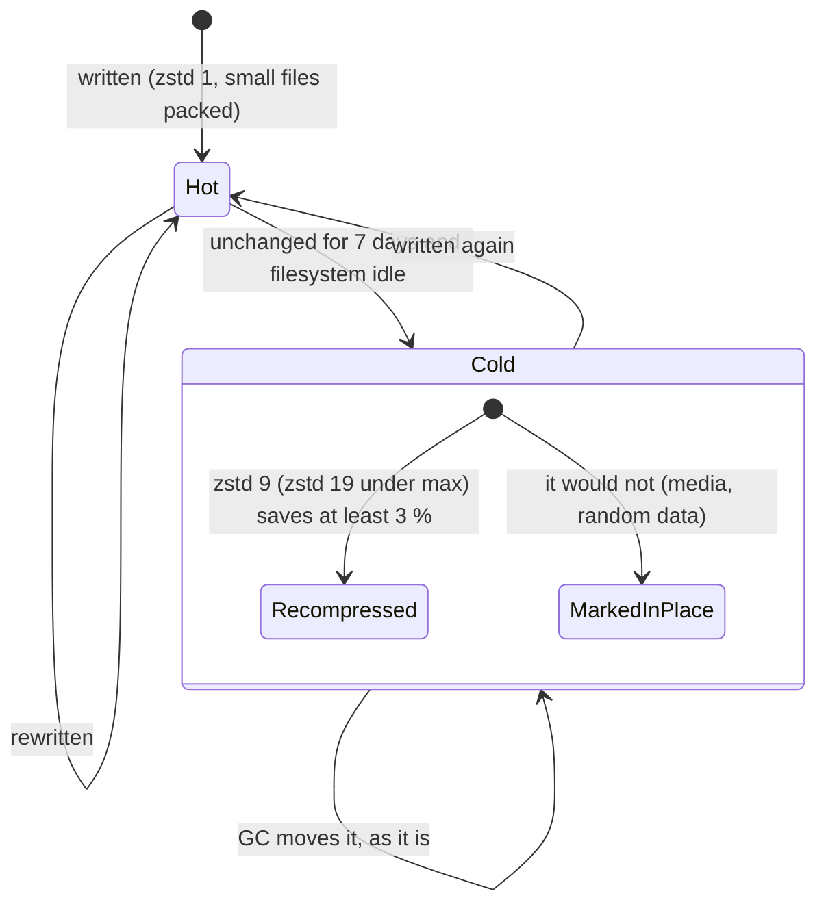

### 7.8 Small files

A 300-byte file in a 4 KiB block wastes 93 %. Solutions: **inline** tiny
files inside metadata (as Btrfs does), and **pack** many small files into one
shared compressed chunk, ideally with a zstd dictionary trained on similar
files.

**As built (M4): packing, no inlining.** Measured first (§14): inlining
files up to 2 KiB would take more space (and RAM, while metadata is in
memory) than packing them.

- **What:** at commit, regular files of at most 16 KiB (and one chunk)
  whose whole content is written in that commit, after dedup (a small file
  identical to a stored one or to a piece takes that).
- **Order:** by directory and name for files whose directory changed in
  this commit (new files always qualify), by inode number for the rest
  (rewritten files, usually created together anyway). Neighbours on disk
  are then the files read together (a compiler reading headers, `grep
  -r`). Finding every file's directory would need a scan of all
  directories at every commit, so this is the cheap version of the plan's
  "by directory, then by name".
- **Packs** of up to 64 KiB of data are compressed as one record with the
  `pack` flag; each file refers to its **piece** (offset and length in the
  pack). A file alone in its pack is stored as an ordinary chunk.
- **Reading** a piece decompresses its pack once into the safe-space cache
  (the whole pack), then copies the piece out.
- **Dedup of pieces:** a pack records no identity for its pieces, so a
  match is confirmed by comparing the bytes (a small file's).
- **Changes:** a changed piece is simply written again (packed in the next
  commit, or as a chunk once the file passes 16 KiB). A pack's space is
  freed with its last piece (§8 of the format).
- **GC repacks** a pack it visits whose live pieces are less than half its
  data: decompressed, the live pieces packed again and compressed (outside
  the lock), and each piece re-pointed. *Limit:* victim choice sees a
  pack's whole size as live, so dead space inside packs only goes when GC
  visits their segment for other reasons; a test also showed GC never
  visits the segment being written.

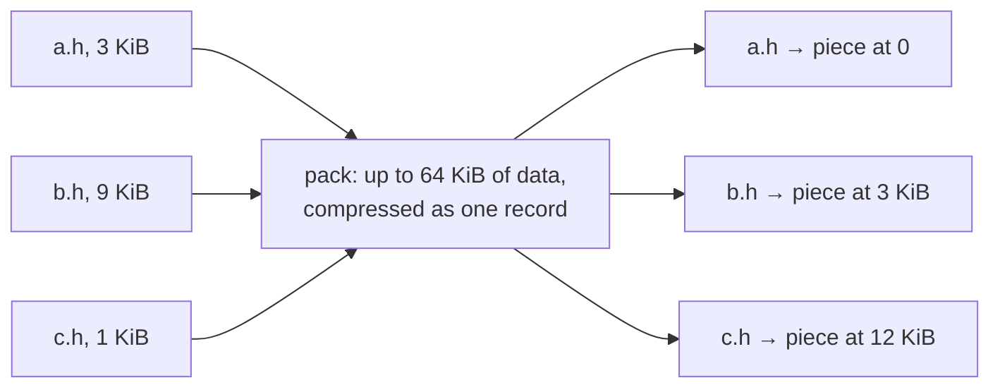

### 7.9 Crash consistency and `fsync`

POSIX promises durability only after `fsync`/`fdatasync`. The classic way
(ext4's journal) is two flushes per commit: write the data, flush, write the
commit record, flush, so the disk cannot reorder the commit record ahead of
the data it describes.

**Nanoer needs only one flush per commit**, thanks to *prefix consistency*
(§7.10): data chunks are appended before the transaction that refers to
them, and replay stops at the first record that is not intact. If the disk
persisted the transaction but not an earlier data chunk, replay stops at
the missing chunk and never reaches the transaction. A crash therefore
always recovers a state that really existed, even if the disk reorders
writes. One `fdatasync` at the end makes the whole commit durable.

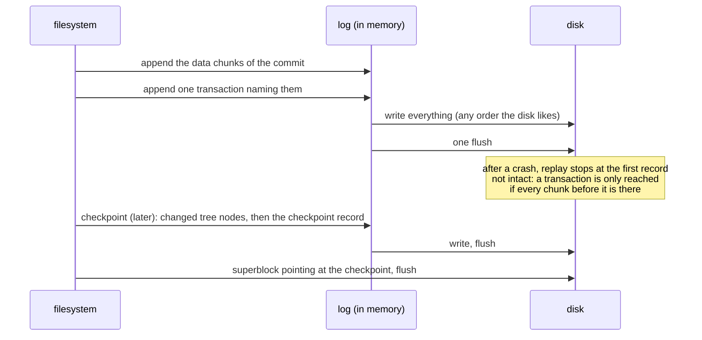

### 7.10 How the M2 engine works

How the pieces fit (as of M6):

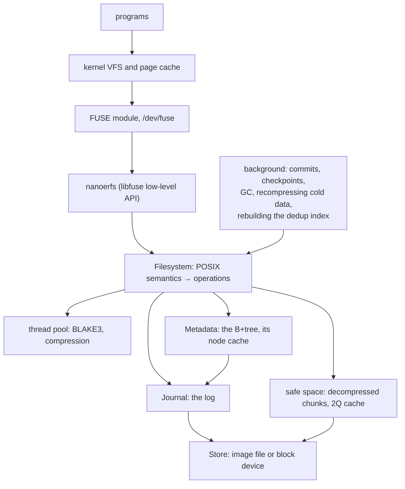

A read and a write:

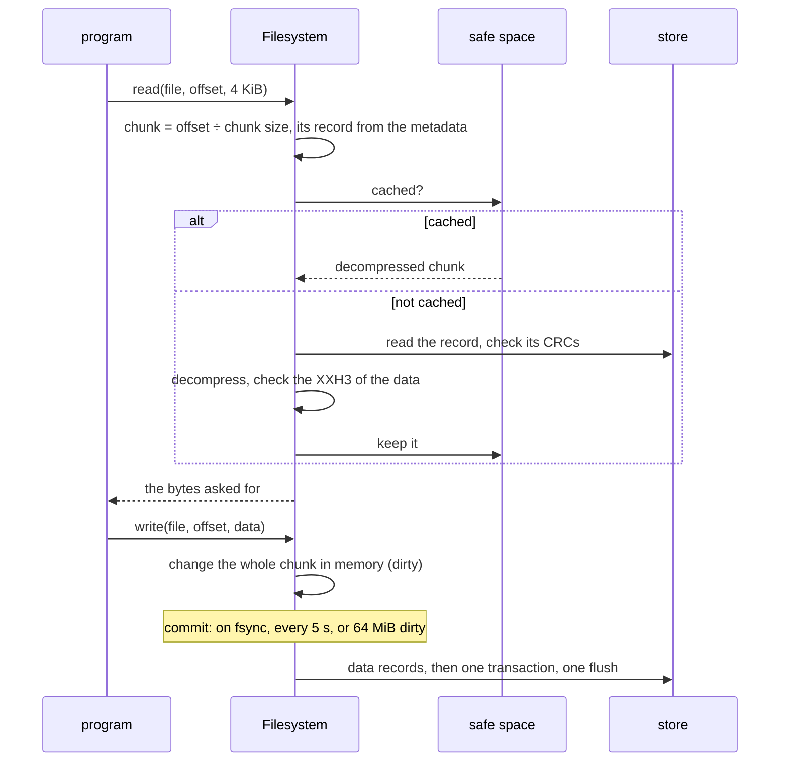

- **One log for everything.** Data chunks, metadata transactions,
  checkpoint parts and segment seals are appended to a single log that runs
  through segments, linked by **seals** ("continue in segment N, sequence
  S"). Replay follows seals only into a segment whose header is intact with
  exactly that sequence number.
- **Physical operations, one `apply()`.** Metadata changes are recorded as
  small physical operations (put inode, set entry, set chunk, …; nine in
  all, `docs/format.md` §8). The live filesystem and log replay run the
  same `Metadata::apply()`, so a recovered state is, by construction, the
  state that was live. The filesystem layer turns POSIX semantics (rename
  rules, link counts, …) into operations; replay never re-runs that logic.
- **Commits.** Operations take effect in memory at once and queue up; file
  data is kept as whole dirty chunks. A commit compresses the dirty chunks
  in parallel, appends them, appends one transaction (queued operations,
  then the new chunk locations, then the attributes of every changed
  inode), and flushes once. Commits happen on `fsync`, every 5 seconds,
  when 64 MiB of dirty data builds up, or when the queued operations grow
  past half of what a transaction may hold. **Every commit is durable**,
  and `fsync` on one file commits everything queued before it (simpler
  than per-file tracking, and a stronger guarantee).
- **Holes.** A chunk that is entirely zeros is never written: it becomes a
  hole. Files are cut on a fixed grid of `chunk_size`, so a write touches
  only the chunks it overlaps.
- **Checkpoints** (every 256 MiB of log, every 5 minutes if anything was
  written, and at unmount) write the whole metadata as one or more parts and
  point the superblock at them. In M2 the metadata is in memory, so a
  checkpoint rewrites all of it; M6's on-disk B+tree removes that cost.
- **Mount** scans every segment header (sequence numbers must exceed all of
  them), reads the checkpoint, replays the transactions after it, frees
  orphans (files deleted while open when the system went down), seals the
  old log *at* its end (never appending after a possibly torn tail) and
  continues in a new segment.
- **Segment reuse.** Segments with no live data, older than the newest
  checkpoint, are released when a checkpoint is written, and become free
  only after the next one, because the previous superblock may still need
  them if the newest superblock write tears. At mount they are free at
  once: the superblock just read is durable and stays valid for two more
  checkpoints. A reused segment gets a new, higher sequence number, so its
  old records can never be replayed.
- **Running out of space.** Each write is checked against free space before
  anything changes, conservatively (dirty data counted uncompressed at a
  full chunk each). If the check fails, Nanoer commits, writes two
  checkpoints to free released segments, and checks again before returning
  `ENOSPC` (from M4: and collects garbage first, §7.12). A **reserve** of
  segments (3, plus room for 1.5× the last checkpoint, plus 2 that only GC
  may use, from M4) is never used by normal writes, so a checkpoint and the
  next mount always have room. **Deletes, rmdir, removing xattrs and shrinking
  files skip the check**: they are how a full filesystem gets space back,
  and their transactions are tiny. If a filesystem is so full that mount
  cannot start a new segment, it mounts **read-only** with a warning rather
  than refusing.
- **If a write to the store fails** mid-commit, memory holds changes the log
  does not. The filesystem then refuses further changes (`EIO`), like ext4's
  `errors=remount-ro`, rather than let memory and disk drift apart.
- **Limit found in M2:** without copying garbage collection (M4), only
  segments whose data is *entirely* dead are reclaimed. Random rewrites leave
  a little live data in many segments, so space runs out long before the
  data fills it: in the model-based test, about 0.5 MB of live data held 16
  of 23 segments (4 MiB each). Workloads that write files once (copies,
  untar, builds) are unaffected; rewrite-heavy ones (databases, VM images)
  need M4. (M4's garbage collection removes this limit, §7.12.)

### 7.11 Crash safety, damage and `fsck` (M3)

**Damage or crash?** Prefix consistency (§7.9) has a blind spot: replay
stops at the first record that is not intact, whether a crash tore it or
bit rot damaged it in the middle of a long log. In the second case every
later transaction would be silently dropped, and the next mount would
write over them. M3 tells the two apart with one observation: **a crash
can only cut the log short where writes had not been flushed, and nothing
written after an unflushed write can claim that a later transaction was
flushed.** So every transaction records a *durable claim*, the newest
transaction a completed flush had made durable when it was written (stored
as a 32-bit distance back, `durable_back`). After replay stops, Nanoer
scans the rest of the segment at every 8-byte boundary (and follows any
intact seals it finds, even into segments whose header is damaged) for
intact records of the current sequence number. If any claims a
transaction beyond the last one replayed, the log is **damaged**: mount
goes read-only and asks for `fsck` (decision 1). A real torn tail never
triggers it, because what follows a torn write was not flushed either.
Checkpoint parts claim their own `txid`. A transaction that is intact but
contradicts the metadata (say, it removes an entry that does not exist) is
damage too: replay stops before it.

*Known limit:* damage to the last transaction alone, with nothing intact
after it, looks exactly like a crash during that commit, so it is lost
without a report. Every later commit closes the window for the earlier
ones (they claim them).

**Checkpoint fallback.** If the newest checkpoint cannot be read, mount
uses the one the other superblock slot points to and replays the log from
there; the transactions after it lead to the same state. This works only
while the older checkpoint's segments are not reused, which the
two-checkpoint rule (§7.10) protects, with one exception found by the
image fuzzer: freeing dead segments *at mount* reuses segments the older
checkpoint needs. Mount now does that only when it is short of free
segments. If no superblock leads to a readable checkpoint, `fsck --repair`
scans every segment for checkpoint part 0 records, newest first, and uses
the first one that replays cleanly. The same scan rebuilds both
superblocks when both are lost (decision 3): the segment size is found by
voting over the segment headers that would be valid at each size, the UUID
by vote, and the chunk size from the data chunks' offsets.

**Errors flag.** A superblock `state` bit (formerly reserved, so older
readers ignore it) records that damage was seen: a chunk failing its
checksum, damage at mount, a checkpoint fallback. It is set by the next
checkpoint and cleared only by `fsck` once everything is found and
repaired (decision 4). Reads of damaged chunks still return `EUCLEAN` and
are logged with the inode and byte range.

**`nanoer fsck`** (also `fsck.nanoer`, for `fsck -t nanoer` and boot-time
checks) runs in phases: superblocks; segments and the log (with damage
detection); the directory tree (reachability from the root, cycles, `..`,
names, link counts, orphans); space (every chunk points at an intact data
chunk record in a segment in use, owned by that inode at that offset, of
the recorded size, referenced once, within the file; live bytes per
segment); and with `--deep`, every chunk decompressed and verified.
**Repairs work like a mount:** the fixes are physical operations applied
to the metadata in memory, written as one transaction, then a new
checkpoint, then the superblocks. Nothing is changed in place, so a crash
during a repair leaves either the old or the repaired filesystem.
Unreachable files and directories are reconnected under `/lost+found` as
`#<inode>`, keeping each lost subtree whole; damaged chunks become holes
and are listed by file and byte range. `fsck` never guesses at data. Exit
codes follow e2fsck: 0 clean, 1 repaired, 4 errors left, 8 could not run.

**Write ordering.** Every place where order matters, and what enforces it:

1. A data chunk is appended before the transaction that refers to it, in
   the same flush. Replay stops at a missing chunk, so it never reaches
   the transaction (prefix consistency, §7.9).
2. One flush per commit; the commit is durable when it returns.
3. A checkpoint's parts are flushed before the superblock that points to
   them is written, and the superblock is flushed before anything relies
   on it.
4. The superblock goes to slot `generation mod 2`, so the previous one
   survives a torn write; released segments are reused only after the
   *next* checkpoint is durable (§7.10), so both slots' checkpoints stay
   readable.
5. A seal may reach the disk before the header of the segment it points
   to. Replay then ends at the seal (a "dangling" seal), and damage
   detection still scans the target segment.
6. After mount, the log continues after a seal written *at* the end
   found, never after a possibly torn tail.
7. A repair writes its transaction, then flushes, then the checkpoint,
   then the superblocks, as a mount would.
8. A failed write or flush makes the filesystem refuse further changes;
   a mount that fails part way writes nothing (it used to write a
   checkpoint while being torn down).

**How it is tested** (§12): every crash point of a workload, I/O errors at
every point, crafted inconsistencies for each `fsck` repair, random damage,
an image fuzzer, and `kill -9` on a real mount.

How mount and `fsck` find a state to use (M3, with M6's tree):

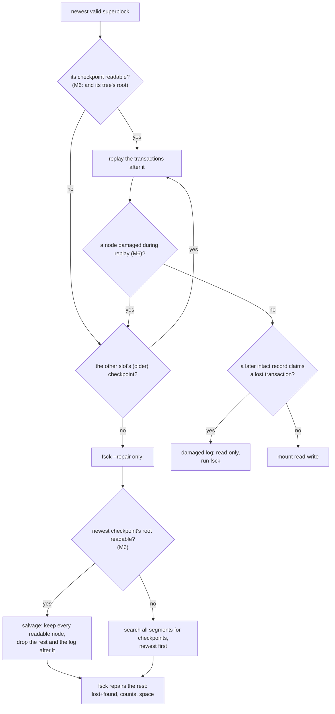

### 7.12 Garbage collection (M4)

**What it does.** It picks segments with little live data, copies their
live records into the log, and re-points the chunks that refer to them;
the existing release rule (§7.10) then frees the emptied segments after two
checkpoints. Payloads are copied as they are, CRCs checked, nothing
decompressed (recompressing cold data is M5's tiering). No format change:
a copy is an ordinary data chunk record, and re-pointing is an ordinary
transaction (SetChunk, or SetChunkRef for shared records and packs).

**A step, in three phases**, so that foreground work waits as little as
possible:

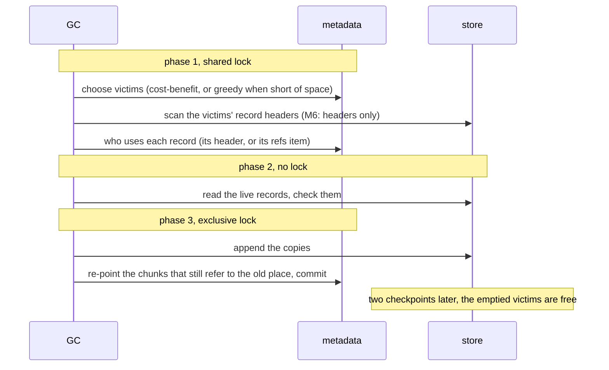

1. under the shared lock: choose victims and list every chunk referring
   into them (one pass over the metadata);
2. with no lock: read the live records and check them;
3. under the exclusive lock: append the copies and re-point only the
   chunks that *still* refer to the old location, then commit.

A victim's sequence number is noted in phase 1 and checked in phase 3: if
the segment was freed and reused meanwhile, the step is dropped (and what
was read is not even taken as damage). A chunk rewritten meanwhile keeps
its new data; its copy is simply dead. (The plan said copies are *written*
without the lock; appending to the log needs the lock, so only the reading
is done without it.) Damaged records are left where they are, reported,
the errors flag set, and that segment is not tried again in this mount.

**Choosing victims.** Cost-benefit as in Sprite LFS, `(1 − u) × age /
(1 + u)` with the sequence number as age, in the background; greedy (least
live data) when space is short. Segments fuller than 75 % (idle), 80 %
(background, low on space) or 97 % (before `ENOSPC`) are not worth copying.

**When.** In the background when the filesystem has had no changes for
10 s and more than 25 % of the space in use is dead, or when free segments
fall below 15 %; before any `ENOSPC`; and offline with `nanoer gc`.

**Space for GC itself** (found by the rewrite test, which failed three
times on the way):

- GC needs somewhere to copy to when the filesystem is full: **2 reserve
  segments only GC may use** (with only one, the checkpoints after a round
  could use it up).
- **A step moves no more live data than there is room for its copies**: a
  victim copied halfway frees nothing and wastes the room.
- **Checkpoints only when they free something:** each may leave a nearly
  full segment behind for a new one.

Copies share the log with new writes, so hot and cold data mix in the same
segments; separating them (as some log-structured systems do) is left for
M5's tiering. (M5 did not separate them either: a tiering step appends
the records it recompresses together, which groups them somewhat; a
separate log for cold data stays an option if GC measurements ask for it.)

---

## 8. Caching: the safe space and read-ahead

### 8.1 The safe space

A memory budget for **decompressed chunks**. Because a single read decompresses
a whole chunk, keeping recent chunks avoids decompressing the same chunk again
for neighbouring reads.

### 8.2 Replacement policies

- **LRU** (least recently used): simple and good for most workloads. Weakness:
  one large scan (a backup, a virus scan, file indexing) flushes everything
  useful.
- **2Q, CLOCK-Pro, ARC** (Adaptive Replacement Cache, Megiddo & Modha, IBM,
  2003; used by ZFS): keep separate "seen once" and "seen repeatedly" lists,
  so scans cannot evict hot data.
- **Nanoer plan:** a sharded LRU first (one lock per shard, so many threads do
  not fight over a single lock), then 2Q or ARC once benchmarks show scan
  pollution.
- **In M2:** a 16-shard LRU, 256 MiB by default (`-o safe_space=`). Chunks are
  keyed by record location **and** the segment's sequence number: when a
  freed segment is reused, the same location holds different data under a
  new sequence number, so a stale entry can never be returned and the cache
  needs no invalidation.
- **In M5: simplified 2Q** (Johnson & Shasha, 1994), chosen by measurement
  (§14): a chunk seen once waits in a FIFO of up to a quarter of the
  budget; asked for again, it moves into the LRU. One pass over data (a
  scan) therefore never pushes out what is used repeatedly. The full 2Q
  (a FIFO, plus a list of keys recently let go, and promotion only from
  that list) was tried first: a working set that was warmed while it fit
  stayed in the FIFO, so the scan evicted it once before it was promoted
  (in a cache-only test, 65 % of it survived a scan against the
  simplified form's 100 %). Shards are at least 4 MiB (fewer shards for a small
  safe space), so that each, and its FIFO (a quarter), holds many chunks.
- **A bug the M5 benchmark found:** the shard was chosen from the low bits
  of `offset × constant ^ seq`. Record offsets are multiples of 8, so the
  low 3 bits of the product were always 0, and a segment's records share
  `seq`: they fell into 2 of the 16 shards, and the safe space held an
  eighth of its budget (8 of 64 MiB). Since M2. The key is now mixed with
  a full 64-bit finaliser; a test checks one segment's records spread over
  every shard.
- **One load per missing chunk (M5):** threads that miss the same chunk at
  once wait for one decompression (`get_or_load`). The kernel reads ahead
  with several requests in parallel, and several can fall in one record
  (a pack; the 1 MiB cold units first built, where each request
  decompressed the whole unit: §7.7).

The simplified 2Q, as built:

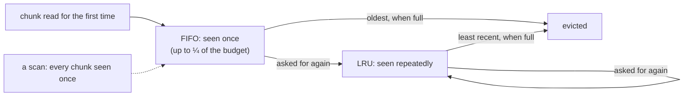

### 8.3 Interaction with the kernel page cache

The kernel already caches file pages that FUSE returns. Decompressed data may
therefore sit in **both** the page cache and the safe space (double caching).
The safe space only has to cover the gap: a chunk is larger than one kernel
read request. Hence it can stay small (a few MiB to a few hundred MiB) and is
user-configurable.

### 8.4 Read-ahead and prefetch

Sequential readers (video, game level loading, file copies) are detected per
open file. The next chunk(s) are decompressed in the background on a thread
pool before they are requested. Linux has its own read-ahead (default
`read_ahead_kb` = 128 KiB); Nanoer's operates at chunk granularity on top of
it.

**Measured before M5 (§14):** the engine streams at ≈ 2,000 MB/s on one
thread but a mount at 808 MB/s: FUSE's round trips, not decompression, set
the speed, so M5 leaves an engine read-ahead out (FUSE already asks for
1 MiB ahead). Decided with the M5 plan; the stage 3 kernel driver changes
the picture, and it is reconsidered there.

---

## 9. Linux internals Nanoer depends on

### 9.1 VFS, inodes, dentries

The **Virtual File System** is the kernel layer every filesystem plugs into.
An **inode** is a file's identity and attributes (size, permissions, owner,
timestamps, link count). A **dentry** maps a name in a directory to an inode.
Hard links are several dentries pointing to one inode. Nanoer must implement
all of this faithfully: permissions, ownership, timestamps, symlinks, hard
links, extended attributes (xattrs; SELinux and capabilities live there),
`rename` semantics, sparse files and `mmap`.

### 9.2 FUSE (Filesystem in Userspace)

Merged into Linux 2.6.14 (2005), by Miklos Szeredi.

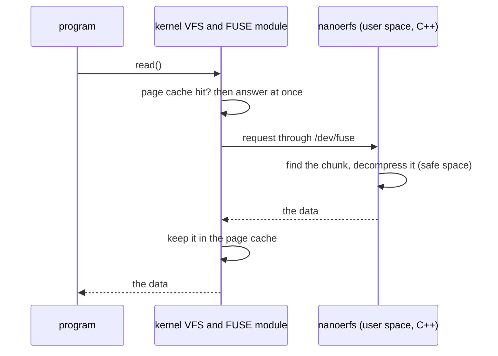

- **libfuse 3** offers a *high-level* (path-based) API and a *low-level*
  (inode-based) API. **Nanoer uses the low-level API**: it maps directly onto
  inode-based metadata, avoids path lookups on every call, and gives control
  over replies and caching.
- **Writeback cache** (`FUSE_CAP_WRITEBACK_CACHE`): the kernel batches small
  writes into larger ones before sending them, which is essential for
  performance.
- Request size: recent kernels allow up to 1 MiB per request (`max_pages`).
  Larger requests mean fewer user/kernel round trips.
- **FUSE passthrough** (Linux 6.9) lets a FUSE filesystem hand a plain backing
  file to the kernel. It does not apply to compressed data, but is useful for
  raw-stored files.
- **FUSE over io_uring** (Linux 6.14) cuts per-request overhead and is a
  future performance option.
- **Why FUSE for stages 1–2:** safe (a bug crashes nanoerfs, not the kernel),
  allows C++, quick to develop and debug. **Cost:** context switches and data
  copies make it slower than in-kernel filesystems, which is the reason for
  stage 3.

**How `nanoerfs` uses FUSE (M2):**

- libfuse 3.12+ low-level API (`FUSE_USE_VERSION 312`), multi-threaded loop
  (up to 16 threads), writeback cache on, 1 MiB requests and read-ahead.
- **`default_permissions`**: the kernel checks permissions from mode, uid and
  gid, so Nanoer does not reimplement access checks.
- **Attribute and name cache timeouts of 60 s.** Every change goes through
  the one mount (the store is locked against other writers), and the kernel
  updates its own caches for those changes, so they cannot go stale. Going
  from 1 s to 60 s made untar ~15 % and a warm `grep -r` ~17 % faster.
- **No `lseek` operation.** With the writeback cache, freshly written data
  can still be in the kernel's page cache when `SEEK_DATA`/`SEEK_HOLE`
  arrives, so Nanoer would report a hole where there is data, and tools
  that skip holes (`cp`, `tar`) would lose it. Without the operation the
  kernel treats the whole file as data: holes are not reported, which POSIX
  allows, and data is never skipped. Found by the POSIX suite on a real mount.
- **Lookup counting.** Every successful lookup, create and link counts as a
  kernel reference until `forget`. `readdirplus` counts every entry it
  returns except `.` and `..`, so it checks that an entry fits in the reply
  buffer *before* looking it up. A deleted file is freed only when it has no
  links, no kernel references and no open handles.
- **`readdir` serves a snapshot** taken at `opendir`, so entries added or
  removed meanwhile can never make a listing skip or repeat a name.
- **Threads after `fork`.** `nanoerfs` daemonizes (forks) after mounting.
  Threads do not survive `fork()`, so the compression pool and the commit
  thread start only afterwards.
- **`mount.nanoer`** is the same program; `mount -t nanoer IMAGE DIR` and
  `/etc/fstab` work. fstab-only options (`defaults`, `nofail`, `_netdev`,
  `x-*`, atime options) are accepted and ignored.
- **atime** is never updated on reads (decision 3 of the M2 plan).
- **`st_blocks`** reports *uncompressed* data, as Btrfs does. Reporting the
  compressed size would make tools such as `cp` and `tar` think files are
  sparse. Compressed sizes are shown by `nanoer info`.

### 9.3 Why the kernel driver cannot be C++

The Linux kernel accepts C and, since Linux 6.1 (2022), **Rust**. C++ is
excluded: it needs a runtime (exceptions, RTTI, global constructors) the
kernel does not provide, and the kernel community has rejected it. Therefore
the **on-disk format must be specified independently of the C++ code**
(`docs/format.md`), so that a C or Rust kernel driver can implement it later.

### 9.4 Booting from Nanoer (stage 2)

- **initramfs:** a small in-memory root filesystem the kernel starts first. It
  loads drivers and mounts the real root. Nanoer adds a hook there to start
  nanoerfs and mount the system image.
- **overlayfs** (in the kernel since 3.18): stacks a writable *upper* layer
  over a read-only *lower* layer. Used by Docker and live USBs. A candidate
  for combining the read-only system image with the writable layer.
- **Image-based OSes** do this today: SteamOS, Fedora Silverblue, Android
  (EROFS system partitions).

### 9.5 Memory: demand paging, and why Nanoer does not reduce RAM

A common assumption is that loading a chunk instead of the whole program
saves RAM. It does not, because Linux already loads programs lazily:

- **Demand paging:** executables and libraries are memory-mapped (`mmap`).
  A 4 KiB page is read into RAM only when the program first touches it, and
  unused clean pages can be dropped under memory pressure and re-read later.
  The whole program is never loaded at once, with or without Nanoer.
- **A program's RAM use is mostly its own data:** heap allocations, decoded
  textures, levels, documents, browser tabs. Storage format does not change
  it.
- **Nanoer adds RAM:** the safe space (configurable), metadata, and possible
  double caching with the kernel page cache (§8.3).
- **What Nanoer does save:** disk space, and fewer bytes read from disk. On
  slow storage (HDD, SD card, USB) that can make loading faster, at the cost
  of CPU time for decompression.

**Technologies that do reduce RAM use** compress memory pages themselves,
separately from the filesystem:

- **zram:** a compressed block device in RAM, used as swap. Fedora enables it
  by default (since Fedora 33).
- **zswap:** a compressed in-RAM cache in front of a swap device.
- Windows and macOS have built-in memory compression too.

They typically fit 2–3× more inactive memory into the same RAM *(approx.)*,
at some CPU cost. A later Nanoer stage could configure them with good
defaults, but they are not part of the Nanoer filesystem.

---

## 10. Existing systems and how Nanoer differs

| System | Type | Compression | Dedup | Licence | Notes |
|---|---|---|---|---|---|
| **Btrfs** | in-kernel CoW filesystem, read-write | zlib, LZO, zstd (since 4.14); 128 KiB extents | out-of-band only (`duperemove`) | GPL-2.0 | Fedora default with zstd:1 |
| **ZFS / OpenZFS** | CoW filesystem + volume manager | LZ4, zstd, gzip; per record (default 128 KiB, up to 16 MiB) | in-line, RAM-hungry | CDDL (cannot be merged into Linux) | ARC cache |
| **EROFS** | in-kernel, read-only (since 5.4) | LZ4, LZMA, DEFLATE, zstd; fixed-size output | yes | GPL-2.0 | Android system partitions |
| **squashfs** | in-kernel, read-only | gzip, LZO, xz, LZ4, zstd; blocks up to 1 MiB | duplicate files | GPL-2.0 | live USBs, snaps |
| **DwarFS** | FUSE, read-only, C++ | zstd, LZMA, Brotli, … | strong (segmenting) | GPL-3.0 | extreme ratios on similar files |
| **dm-vdo** | kernel block layer (since 6.9) | LZ4 | in-line, block-level | GPL-2.0 | under any filesystem |
| NTFS / Windows CompactOS (WOF) | Windows | LZNT1; XPRESS4K–16K, LZX | — | proprietary | `compact /exe:lzx`, popular for games |
| APFS (decmpfs) | macOS | zlib, LZVN, LZFSE | — | proprietary | system files |

**Intended advantages for Nanoer** (to be proven by benchmarks, not assumed):

1. **Automatic hot/cold tiering:** fast writes, maximum compression for cold
   data, with no manual recompression (§7.7).
2. **Combined dedup and compression** with a user-controlled memory budget
   (the safe space).
3. **Per-folder policies:** for example, games use LZ4 and archives use LZMA.
4. **Works without reformatting** (stage 1): the store lives in an image file
   on any existing filesystem.
5. One format spanning read-write folders (stage 1), a whole-OS image
   (stage 2) and a kernel driver (stage 3).

Yardstick: **Btrfs with zstd compression.** If Nanoer cannot beat it on space,
speed or features for some realistic workload, the design is reconsidered.

---

## 11. Tech stack and reasons

| Component | Choice | Licence | Why |
|---|---|---|---|
| Language (engine, tools) | **C++20** | — | speed, control over memory and threads, mature libraries; `std::span`, concepts, `<bit>`, `std::jthread` |
| Language (future kernel driver) | C or Rust | — | the only languages the kernel accepts (§9.3) |
| Compilers | GCC 13+, Clang 18+ | — | both in CI; Clang for sanitizers and libFuzzer |
| Build system | **CMake** 3.20+ | BSD-3 | industry standard; IDE support; `compile_commands.json` |
| FUSE | **libfuse 3** (low-level API) | LGPL-2.1 | the standard; LGPL allows linking from Apache-2.0 code |
| Codecs | **zstd**, **LZ4**, **liblzma** | BSD/GPL-2.0, BSD-2, 0BSD | §3 |
| Hashes | **xxHash** (XXH3), **BLAKE3**, CRC-32C | BSD-2, CC0/Apache-2.0, own code | §5 |
| Unit tests | **GoogleTest** | BSD-3 | widely used, good C++ support |
| Fuzzing | libFuzzer (LLVM) | Apache-2.0 with LLVM exception | fuzz the format parser and codecs with random and corrupt input |
| Sanitizers | ASan, UBSan, TSan | — | catch memory errors, undefined behaviour and data races |
| POSIX conformance | pjdfstest; fsx | test tools only, not shipped | standard filesystem test suites |
| Benchmarks | fio, plus real workloads (untar, compile, game loads) | GPL-2.0 (tool only) | standard I/O benchmark |
| CI | GitHub Actions, Ubuntu runners | — | FUSE available on hosted runners |

Dependencies come from distribution packages located through `pkg-config`,
at pinned minimum versions. Every dependency and its licence is listed here
(supply-chain hygiene, §3.3).

**Versions in use** (Ubuntu 24.04, 2026-10-24): zstd 1.5.5, LZ4 1.9.4,
XZ Utils / liblzma 5.4.5 (from before the 5.6.0/5.6.1 backdoor), xxHash
0.8.2, libfuse 3.14.0 (used from M2), GoogleTest 1.14.0, CMake 3.28,
GCC 13.3, Clang 18. Minimum versions required by the build: zstd 1.4.5,
LZ4 1.9.0, liblzma 5.2.0, xxHash 0.8.0.

**BLAKE3** is vendored in `third_party/blake3`: the official C
implementation 1.3.1, taken from Ubuntu's `librust-blake3-dev` package
(signed archive) because GitHub downloads were blocked in the build
environment. `SHA256SUMS` pins every file, and CI checks it. The portable,
SSE2, SSE4.1, AVX2, AVX-512 and NEON code paths are built with runtime CPU
detection.

**Error handling:** the engine throws `nanoer::Error`, which carries a
category (I/O, corrupt, invalid argument, unsupported, no space, busy) and
the system errno. The FUSE adapter converts it to an errno at the boundary.
Corruption is reported as `EUCLEAN`, as Btrfs and ext4 do. Exceptions were
chosen over error-code returns because they keep the many layers of
storage code readable, and C++ is never used in the kernel anyway (§9.3).

**CRC-32C** is Nanoer's own code: the SSE4.2 `crc32` instruction on x86-64
or the ARMv8 CRC instructions, detected at run time, with a slicing-by-8
table fallback that processes 8 bytes per step.

---

## 12. Testing and verification techniques

- **Unit tests:** codecs round-trip, checksums, format encode/decode, cache
  eviction, allocator.
- **Model-based testing:** run random operation sequences against Nanoer and
  an in-memory reference model, and compare results after every step.
- **fsx (file system exerciser):** random reads, writes, truncates and mmaps
  with data verification. It finds subtle data-corruption bugs.
- **pjdfstest:** POSIX semantics (permissions, rename, links, …).
- **Crash testing:** a test backing store records every write and flush, then
  simulates a power cut at each point by discarding unflushed writes,
  remounts, and checks the filesystem is consistent and synced data is
  present. (Same idea as Linux's `dm-log-writes` and the CrashMonkey
  research tool.)
- **Fuzzing:** feed corrupted or random images to the mounter and `fsck`.
  They must reject them cleanly, never crash or return wrong data.
- **Sanitizers** on every CI run.
- **In M1:** 59 unit tests (GoogleTest), an end-to-end test of the tools,
  ASan + UBSan builds with GCC and Clang, a ThreadSanitizer build, and three
  libFuzzer targets (decompressors, codec round trips, on-disk structure
  parsing) with seed inputs in `fuzz/seeds`. **Lesson:** fuzz coverage was
  near zero until the library itself was compiled with
  `-fsanitize=fuzzer-no-link`. Instrumenting only the fuzzer's entry file
  is not enough.
- **In M2:** 103 unit tests plus an end-to-end test of the tools, including:
  - a **model-based test** (4 seeds × 1,500 random operations against a
    simple reference model, with remounts and simulated power cuts mixed
    in; a crash must roll the filesystem back to exactly the last sync);
  - journal tests where unflushed writes are randomly kept, dropped or torn,
    and the recovered state must equal one that really existed;
  - tests for running out of space and recovering from it.

  On a **real FUSE mount**: a 15-test POSIX suite (`tests/integration`),
  `nanoer-fsx` (random reads, writes, truncates, hole punches, mmap reads
  and writes, checked byte by byte against a shadow copy), and a
  persistence test (copy a tree, remount, `diff -r`). **pjdfstest** and
  **xfstests' fsx** run in CI only: neither is packaged for Ubuntu, and
  GitHub was not reachable from the development environment.
- **Lesson:** a test filter (`Fs*`) silently did not match the model test's
  name (`Seeds/FsModel...`), so it was believed to pass before it had ever
  run. Check that a test actually ran (ctest's count, or `--gtest_list_tests`)
  before relying on its result.
- **Lesson:** headers include each other differently between standard
  library versions. Code that used `std::min({...})` without `<algorithm>`
  built against libstdc++ 13 but not against the CI runners' libstdc++ 14.
  Include what you use; the development environment now also has
  libstdc++ 14 installed, so Clang builds there match CI.
- **Lesson:** a test that copies a tree and compares it must use a tree
  nothing else is writing to. Copying the source tree failed spuriously
  while a build was running inside it.
- **Lesson:** a fuzzer's checks must follow the specification, not a
  stricter guess. `fuzz_parse` demanded that an accepted superblock
  re-encode to the same bytes, but the format ignores reserved bytes, so CI's
  fuzzer (after ~2 million inputs, by constructing a valid CRC) found a valid
  superblock that "failed". The check is now "the canonical encoding is
  stable", and a unit test pins the reserved-bytes rule. CI now keeps
  crashing inputs as artifacts.
- **In M3** (crash safety and `fsck`):
  - **Crash-point exploration**, in the style of CrashMonkey and ALICE: a
    recording store logs every write and flush, per 4 KiB block. A
    300-step workload (mostly incompressible writes, so segments fill
    fast, two delete-everything phases, so segments are reused; sync every
    4 steps) runs once, and a crash image is built after each write in
    several variants (unflushed writes all lost, all kept, each dropped
    alone, the last one torn at every sector, random subsets). Each image
    must pass `fsck` with no errors and mount writable, without damage or
    fallback, in the state of the last sync or the one after it. CI
    checks every 11th crash point; `NANOER_EXHAUSTIVE=1` (nightly) checks
    every one. Crashes during mount itself and during repairs are covered
    the same way.
  - **I/O errors:** a write or flush fails at every position of the same
    workload; afterwards the filesystem must refuse changes, and the image
    must mount consistent, in the state before or after the failed commit
    (the failure may hit the checkpoint *after* a durable commit).
  - **`fsck`:** a test per inconsistency (crafted transactions written
    into the log), each checking that `fsck` finds it, `--repair` fixes
    it, and the result is clean and still mounts and works.
  - **Damage:** mid-log damage detected (read-only mount), checkpoint
    fallback, damaged file data gives `EUCLEAN`, random damage never
    crashes.
  - **`fuzz_image`**, a libFuzzer target that damages a small valid image
    at fuzzer-chosen bytes, then mounts it and reads everything, runs
    `fsck --repair --deep`, checks that a repair that claims success
    leaves a clean filesystem, and mounts and reads again.
  - **`kill -9` on a real mount** (`run_mounted.sh kill`): a writer
    creates and deletes files, and logs each one to another filesystem
    only after `fsync` returned; fsx, an untar and a build run alongside.
    `nanoerfs` is killed at a random moment; after a lazy unmount, `fsck
    --deep` must find it clean, every logged file must be intact, and the
    remounted filesystem must be writable.
- **Lesson:** a test binary that silently ran 0 tests (a stale build after
  a syntax slip) "passed". Zero tests is a failure, not a pass.
- **Lesson:** the crash workload at first never reused a segment, so the
  most delicate code (reuse) was never crash-tested. The workload now
  asserts that reuse happened.
- **Lesson:** a test workload that called `pick()` twice in one argument
  list ran a different workload under Clang than under GCC: the order in
  which arguments are evaluated is unspecified (GCC goes right to left).
  An assertion about the workload's shape held for one and not the other.
  One random draw per statement keeps generated workloads the same
  everywhere.
- **Lesson:** the image fuzzer found, within minutes, a case no hand-written
  test had: on a small store, freeing segments at mount had destroyed the
  older checkpoint, so a damaged newest superblock made the filesystem
  unrecoverable. Fixed twice over: mount frees early only when short of
  space, and `fsck --repair` can find the newest readable checkpoint by
  scanning.
- **In M4** (GC, dedup, packing, stats):
  - **GC:** victim choice; moving data and freeing segments, also on
    filesystems made as M3 made them; random rewrites of 10× a small
    store's size at ≈80 % full without `ENOSPC`; a chunk rewritten, and a
    segment freed and reused, while GC holds its copies; damaged data left
    in place; background GC when idle.
  - **Dedup:** the index against a map through 60,000 random operations;
    identical files within and across commits; changing, truncating and
    deleting one copy; the same-commit release case (in both orders); a
    wrong index entry; dedup off; GC moving shared records.
  - **Packing:** what is packed and in what order; changing packed files
    until every pack is released; identical small files sharing a piece;
    GC repacking.
  - **Stats:** every figure checked on a known filesystem, and the
    breakdown adds up exactly.
  - **Everywhere:** the crash-point exploration got a variant with copies
    (dedup) and GC; the model test got copies and GC; fsx and `kill -9` run
    on small stores too (40 MiB and 160 MiB with 1 MiB segments), where GC
    never stops; `fuzz_image`'s base image has shared records and a pack;
    `fuzz_parse` decodes checkpoints and operations.
- **Lesson:** a test that passes without the fix proves nothing. The first
  version of the same-commit dedup test did, because chunks are committed
  in hash-map order and it made only the harmless order; breaking the fix
  on purpose showed it, and the test now makes both orders.
- **Lesson:** the rewrite test failed three times before GC worked on a
  full filesystem, each time on a different design gap (no room for GC's
  copies; steps too big to finish; checkpoints using up the room). A
  workload that fills the store is worth more than many that do not.
- **Lesson:** test data needs care. An all-zero "small file" is stored as
  a hole, text with a short period deduplicates between chunks, and a
  compressible filler does not fill a segment: each made a test measure
  something other than intended until its numbers were checked.
- **Lesson:** building the committed tree with Clang before pushing
  caught a missing `<algorithm>` (libstdc++ 14 includes less), the same
  slip that broke CI in M2.
- **Lesson:** a ThreadSanitizer run that silently did not start (its half
  of a background job never ran) let a data race through to CI: the
  vendored BLAKE3 detects CPU features through a plain global on first
  use, and dedup made several threads hash at once. Fixed by hashing once
  under a thread-safe static before any concurrent use (the library
  itself is not edited); removing the fix brings the TSan report back. A
  check that produced no output has not passed.
- **Lesson:** CI's parse fuzzer found that a damaged checkpoint with an
  offset beyond 256 TiB made the dedup index throw `invalid_argument`
  (only `corrupt` is acceptable from a damaged image). The index is a
  hint, so such a target is now simply not indexed; the input is a seed.
- **M5 (cold data, policies, 2Q):**
  - **Tiering:** every chunk of a cold file recompressed on its own, packs
    and shared data; incompressible data only marked; a chunk written, a file
    deleted (and its segments reused) between reading and re-pointing;
    damaged data left in place and not tried again; no room, no error;
    GC recompressing instead of copying; the background pass; filesystems
    without the feature; copies of cold data still deduplicated.
  - **Policies:** each policy's codec and cold form, inheritance (not by
    symlinks, not by what existed before), invalid values (`EINVAL`) and
    other `user.nanoer.` names (`EPERM`), packs per policy, M4 filesystems.
  - **Everywhere:** the crash-point exploration got a variant that
    recompresses (by itself and through GC; 2,499 crash images, all
    recovering a real state); the model test recompresses and counts every
    file cold at once; `fsck` checks cold data clean, reports a damaged
    cold record by file and byte range, and rebuilds lost superblocks from
    cold data; the image fuzzer's base image has cold data;
    fsx and `kill -9` run with `cold_after=0,idle=0` on real mounts.
- **Lesson:** a benchmark that looks wrong is worth explaining before
  trusting. The scan benchmark's first numbers showed an 8 MiB cache
  where 64 MiB was configured: the safe space had used 2 of its 16 shards
  since M2 (§8.2). Every earlier measurement that depended on the cache's
  size was made with an eighth of it.
- **Lesson:** a new test of an old path found an old bug: rebuilding lost
  superblocks guessed the chunk size from `file_offset / index` of any
  chunk, which is wrong for a pack's pieces and for data another file
  wrote first. It now uses only the file's own records, else the size of
  a chunk followed by another.
- **Lesson:** ThreadSanitizer caught, only under a loaded parallel run, a
  race in the background pass: it counted a pass in the statistics while
  holding only the shared lock, and `info()` reads them under the shared
  lock too. Counters now change under the unique lock. Run alone the test
  passed 15 times out of 15; six copies in parallel reported the race in
  4 of 6 runs without the fix and 0 of 6 with it.
- **Lesson:** `recompress_cold` commits first, so a test that wanted a
  file to stay uncommitted (not cold) had to inspect a plan instead.
- **Benchmarks** compared with ext4 (no compression) and Btrfs + zstd: space
  used, throughput, latency, CPU time.

---

## 13. Licensing

**Decision: Nanoer is licensed under Apache-2.0** (2026-10-24). See `LICENSE`.

- **What Apache-2.0 allows:** use, modification and distribution, including
  commercially and in closed products, provided the licence and copyright
  notices are kept and modified files are marked as changed.
- **Patent grant:** every contributor grants users a licence to any of their
  patents the contribution uses. The grant terminates for anyone who sues
  claiming the project infringes a patent. This is the main reason to prefer
  it over MIT.
- **Why not GPL:** a permissive licence makes adoption by distributions,
  companies and other projects easier, and Nanoer's value grows with
  adoption.
- **Kernel caveat (stage 3):** kernel modules must be GPL-compatible. The
  kernel driver will be licensed **"Dual MIT/GPL"** (or GPL-2.0), declared
  with `MODULE_LICENSE("Dual MIT/GPL")`. Apache-2.0 code cannot simply be
  copied into the kernel, because Apache-2.0 is incompatible with GPL-2.0.
  This is another reason the on-disk format is specified separately (§9.3).
- **Dependency licences:** all compatible with Apache-2.0 (§11). libfuse is
  LGPL-2.1: linking to it dynamically is fine. Modifying libfuse itself would
  make those changes LGPL.
- **GPL-licensed tools** (fio, xfstests' fsx) are used for testing only and
  never shipped or linked.

*This is general information, not legal advice.*

---

## 14. Measurements

### 2026-10-23: compressibility of Linux system files

A 290 MiB sample of `/usr/bin`, `/usr/lib`, `/usr/share` (Ubuntu 24.04
container), compressed in independent chunks. Stored-raw fallback applied.

| Chunk size | zlib level 6 | LZMA preset 1 |
|---|---|---|
| 128 KiB | 35.9 % | 31.5 % |
| 4 MiB | 35.5 % | 29.9 % |

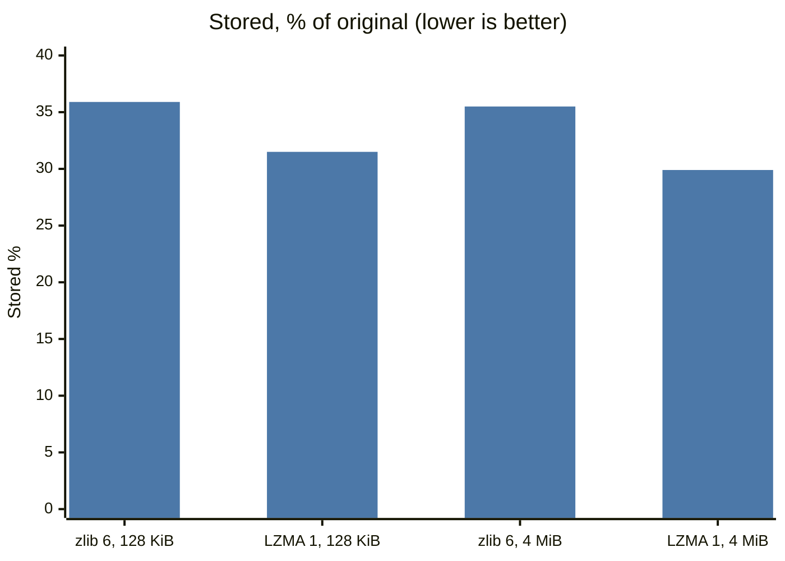

**Conclusions:** system files compress well, so 800 → 500 GB is achievable
for OS and application data. (This sample was later found to be skewed
toward a few large files; the 2026-10-24 C++ benchmark is the reference.) Bigger chunks help only slightly, so
128 KiB is a sound default for writable data.

### 2026-10-24: codec benchmark on Linux system files (C++ engine)

`nanoer bench --max-size 256M --per-file 1M /usr/bin /usr/lib /usr/share
/usr/include`: 256 MiB from 4,158 files, 128 KiB chunks, one thread,
incompressible chunks stored raw. Release build, Intel Xeon @ 2.80 GHz
(cloud VM, 4 cores), Ubuntu 24.04.

| Codec | Level | Stored | Compress MB/s | Decompress MB/s |
|---|---:|---:|---:|---:|
| lz4 | 0 | 51.9 % | 365 | 3218 |
| lz4 | 9 | 45.2 % | 32 | 3373 |
| zstd | 1 | 42.5 % | 248 | 1099 |
| zstd | 3 | 41.0 % | 188 | 1055 |
| zstd | 9 | 39.0 % | 51 | 976 |
| zstd | 19 | 37.2 % | 2 | 782 |
| lzma | 1 | 36.7 % | 13 | 41 |
| lzma | 6 | 35.5 % | 4 | 42 |

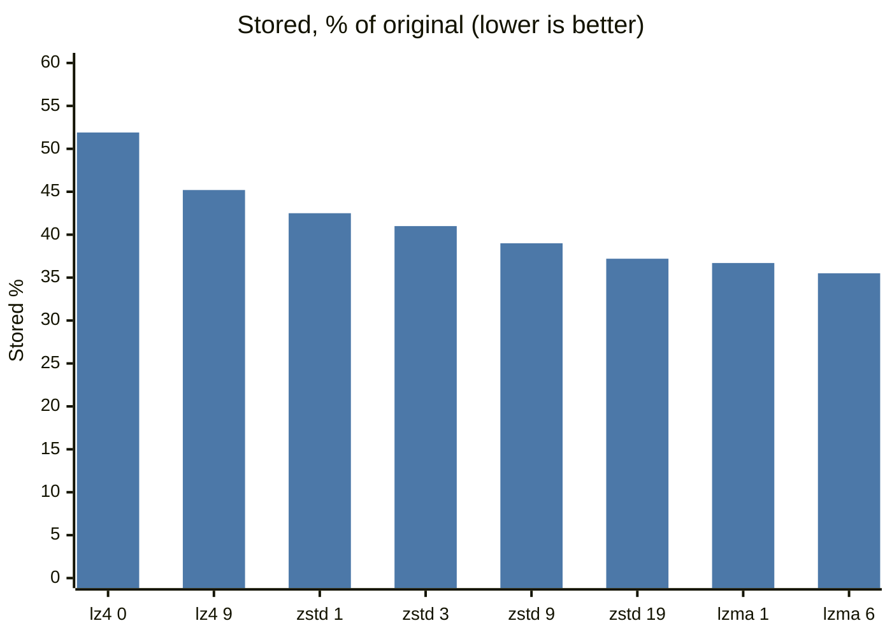

```mermaid
%%{init: {"themeVariables": {"xyChart": {"plotColorPalette": "#4C78A8, #F58518"}}}}%%
xychart-beta
    title "Speed, MB/s: bars decompress, line compress"
    x-axis ["lz4 0", "lz4 9", "zstd 1", "zstd 3", "zstd 9", "zstd 19", "lzma 1", "lzma 6"]
    y-axis "MB/s" 0 --> 3500
    bar [3218, 3373, 1099, 1055, 976, 782, 41, 42]
    line [365, 32, 248, 188, 51, 2, 13, 4]
```

**Conclusions:**
- Even the fastest setting (LZ4) stores OS files at about half their size,
  and the default for new writes (zstd 1, 42.5 %) is well below the 62.5 %
  target.
- **Hot/cold tiering is confirmed worthwhile:** recompressing cold data from
  zstd 1 to zstd 19 saves another ~5 points of the original size, and still
  decompresses at ~780 MB/s.
- **LZMA is a poor default even for cold data:** only ~1.7 points smaller
  than zstd 19, but decompresses ~19× slower (42 vs 782 MB/s). Keep it for
  explicit "max" policies only.
- The earlier Python measurement (§14, 2026-10-23: 31.5–35.9 %) used a
  different sample (the first 300 MB of a directory walk, dominated by a few
  large files) and is not directly comparable. This one, spread over many
  files, is the reference.

### 2026-10-24: M2, the mounted filesystem against ext4

Release build; image file on the same ext4 disk; 4-core VM; single runs,
so take differences under ~20 % as noise.

**Space.** The same content (`/usr/include`, Python 3.12's standard library,
Nanoer's git repository and its build output), 95.3 MiB logical, 6,317
files:

| | Disk used |
|---|---:|
| ext4 | 110 MB |
| Nanoer (actual blocks of the image file) | **32 MB** |
| Nanoer stored data | 29.0 MiB = **30.5 %** of logical |

```mermaid
%%{init: {"themeVariables": {"xyChart": {"plotColorPalette": "#4C78A8, #F58518"}}}}%%
xychart-beta
    title "Disk used for 95.3 MiB of OS-like files, MB"
    x-axis ["ext4", "Nanoer (image file)"]
    y-axis "MB" 0 --> 120
    bar [110, 32]
```

That is **71 % less disk** than ext4 for OS-like content, well past the
37.5 % the 800 → 500 GB goal needs.

**Time** (seconds; "cold" means after a remount, so the kernel's page cache
is empty):

| Workload | ext4 | Nanoer |
|---|---:|---:|
| untar 104 MB of headers + Python | 2.4 | 5.7 |
| copy 512 MB incompressible | 1.1 | 2.4 |
| copy a 60 s 720p H.264 video | 0.05 | 0.05 |
| `git clone` (local) | 0.11 | 0.39 |
| `cmake` configure | 1.1 | 1.2 |
| compile Nanoer (4 jobs) | 8.0 | 7.9 |
| `git status` | 0.01 | 0.03 |
| `find` all files | 0.02 | 0.13 |
| `grep -r`, warm | 0.10 | 0.78 |
| read 512 MB, cold | 0.46 | 0.77 |
| decode the video, cold | 2.5 | 2.6 |
| `grep -r`, cold | 0.74 | 1.7 |
| `tar` the tree, cold | 0.24 | 0.88 |
| `rm -rf` everything | 2.1 | 1.1 |

Nanoer's time as a multiple of ext4's (1 = as fast; from the table above):

```mermaid
%%{init: {"themeVariables": {"xyChart": {"plotColorPalette": "#4C78A8, #F58518"}}}}%%
xychart-beta horizontal
    title "Nanoer (M2) time ÷ ext4 time"
    x-axis ["untar", "copy 512 MB", "copy video", "git clone", "cmake", "compile", "git status", "find", "grep warm", "read 512 MB cold", "decode video cold", "grep cold", "tar cold", "rm -rf"]
    y-axis "× ext4" 0 --> 8
    bar [2.4, 2.2, 1.0, 3.5, 1.1, 1.0, 3.0, 6.5, 7.8, 1.7, 1.0, 2.3, 3.7, 0.5]
```

**Conclusions:**
- **CPU-bound work is unaffected** (compiling, video decoding), and the
  compile *from* a compressed filesystem is as fast as from ext4.
- **Metadata-heavy work pays the FUSE price:** 2–9× slower for many small
  files (untar, find, grep). Each file costs several user/kernel round
  trips. This is M5's tuning target and ultimately the reason for the stage
  3 kernel driver.
- Large sequential I/O is about 2× slower; cold reads run at ~660 MB/s.

### 2026-10-24: M3, crash points, damage and kill -9

Release build, 4-core VM.

| Test | Result |
|---|---|
| Every crash point of the crash workload (1,584 block writes and flushes, 76 syncs, 6 segment starts in 4 segments), every variant | **46,618 crash images, all recovered a real state**, all `fsck`-clean, no false damage reports; 13 min |
| The same, every 11th crash point (CI per push) | 2,044 images |
| Crashes during mount; a disk error at every write and flush | all consistent |
| `fuzz_image`, after the checkpoint-rescue fix | 10,610 damaged images in 8 min, no failure (≈22 images/s: each is mounted, read, repaired, checked deeply, mounted again) |
| `kill -9` of `nanoerfs` with an fsync writer, fsx, an untar and a build running, 8 rounds | every round `fsck --deep` clean, all 2,000–2,200 durable files intact, writable after remount |
| `fsck --deep` of an M2 test image | clean, 6,105 chunks verified |

Crash exploration is dominated by system time (building and mounting
images in memory), so it parallelises poorly; nightly CI runs it whole.

### 2026-10-26: M4 against M3 on real mounts

Release builds of both (M3: commit `a44188c`), image files on the same
disk, 4-core VM, the same commands in the same order, page cache warm.

**A copy of `/usr`** (77,273 files, 4.4 GiB):

| | M3 | M4 |
|---|---:|---:|
| stored data | 1.7 GiB = 38.7 % of logical | 1.7 GiB = **37.4 %** |
| image file, allocated | 1,840,116 KiB | **1,785,668 KiB (−3.0 %)** |
| `cp -a` time | 124.6 s | 116.6 s |
| `nanoerfs` memory after the copy | 304 MiB | 347 MiB |

```mermaid
%%{init: {"themeVariables": {"xyChart": {"plotColorPalette": "#4C78A8, #F58518"}}}}%%
xychart-beta
    title "Stored, % of logical (lower is better)"
    x-axis ["/usr, M3", "/usr, M4", "duplicates, M3", "duplicates, M4"]
    y-axis "Stored %" 0 --> 45
    bar [38.7, 37.4, 31.7, 22.0]
```

`nanoer stats` on M4's copy: holes and zeros 24.4 MiB, dedup 125.7 MiB
(2.8 % of logical, 2,082 records shared), compression 2.6 GiB, 64,352
small files in 2,900 packs, 44,278 records; dedup index 90,629 contents in
2.0 MiB; metadata about 35.6 MiB. The pre-plan model (§14 below)
predicted 38.7 % for M3, exactly, and about 37.3 % for M4. Most of the
memory both use is the safe-space cache (256 MiB).

Where M4's saving on `/usr` comes from (`nanoer stats`, MiB):

```mermaid
pie showData
    title Saved on a 4.4 GiB copy of /usr
    "compression" : 2662
    "dedup" : 125.7
    "holes and zeros" : 24.4
```

**A duplicate-heavy set**, 218 MiB: `/usr/include` twice, the Python 3.11
and 3.12 standard libraries, and this repository cloned three times:

| | M3 | M4 |
|---|---:|---:|
| stored data | 69.2 MiB = 31.7 % | **47.9 MiB = 22.0 % (−31 %)** |
| image file, allocated | 75,188 KiB | 53,708 KiB |

**Speed** (the M2 workloads, seconds, median of three runs each; this VM
is noisy: one M3 compile took 37.9 s, another 15.9 s):

| Workload | M3 | M4 |
|---|---:|---:|
| untar 104 MB of headers + Python | 6.84 | 7.44 |
| copy 512 MB incompressible | 2.13 | 3.34 |
| copy a 60 s 720p video | 0.23 | 0.19 |
| `git clone` (local) | 0.62 | 0.75 |
| `cmake` configure | 1.11 | 1.18 |
| compile Nanoer (4 jobs) | 19.10 | 21.12 |
| `git status` | 0.06 | 0.06 |
| `find` all files | 0.20 | 0.18 |
| `grep -r`, warm | 0.93 | 0.97 |
| read 512 MB, cold | 0.58 | 0.62 |
| decode the video, cold | 2.37 | 2.55 |
| `grep -r`, cold | 1.75 | 1.65 |
| `tar` the tree, cold | 1.16 | 1.23 |
| `rm -rf` everything | 1.54 | 1.57 |

```mermaid
%%{init: {"themeVariables": {"xyChart": {"plotColorPalette": "#4C78A8, #F58518"}}}}%%
xychart-beta horizontal
    title "M4 time ÷ M3 time (1 = unchanged)"
    x-axis ["untar", "copy 512 MB", "copy video", "git clone", "cmake", "compile", "git status", "find", "grep warm", "read 512 MB cold", "decode video cold", "grep cold", "tar cold", "rm -rf"]
    y-axis "× M3" 0 --> 1.8
    bar [1.09, 1.57, 0.83, 1.21, 1.06, 1.11, 1.00, 0.90, 1.04, 1.07, 1.08, 0.94, 1.06, 1.02]
```

**Conclusions:**
- On an OS tree M4 saves 3 % (as measured before planning); on data with
  copies, 31 %. The ratio lever left for stage 1 is M5's recompression of
  cold data.
- Speed is unchanged within the noise, except **untar, ≈9 % slower in
  every round**: each commit now hashes, looks up and packs. The 512 MB
  copy varied from 2.3 to 5.9 s on M4 and from 2.1 to 6.9 s on M3: no
  conclusion either way.

### 2026-10-26: garbage collection under random rewrites

`Gc.RewritesNeverFillTheStore`: a 16 MiB store (15 segments of 1 MiB,
6 reserved), 7 MiB of incompressible live data in 256 KiB files (≈78 % of
what normal writes may use), then 160 MiB of random rewrites of 1–4 chunks
of 16 KiB, debug build:

| | |
|---|---|
| `ENOSPC` | never |
| GC copied | 319 MiB: write amplification 3.0 (greedy, at ≈78 % utilisation) |
| after `collect_garbage` | 9 segments in use for 7.06 segments of live data (1.27×) |

```mermaid
%%{init: {"themeVariables": {"xyChart": {"plotColorPalette": "#4C78A8, #F58518"}}}}%%
xychart-beta
    title "GC under random rewrites, MiB"
    x-axis ["live data", "rewritten by the test", "copied by GC"]
    y-axis "MiB" 0 --> 350
    bar [7, 160, 319]
```

Before M4 the same workload fails within one pass over the files.

### 2026-10-27: live reads and writes on a mounted filesystem (M4)

Safe space 50 MiB, release build, this VM:

| | |
|---|---|
| 2 GiB of log text written | 32.8 s, stored in 31 MiB |
| cold 1 MiB read at offset 1 GiB | 92 ms |
| the whole 2 GiB streamed | 9.6 s; nanoerfs peak memory 18 MiB |
| 30-byte edit in the middle of the file | 7 ms; seen by another process at once, kept after remount |
| 120 s 720p video (39 MiB): seek to 1:30, play 5 s, cold | 601 ms |
| the whole video decoded | 4.3 s |
| `fsck --deep` afterwards | clean (16,689 chunks) |

```mermaid
%%{init: {"themeVariables": {"xyChart": {"plotColorPalette": "#4C78A8, #F58518"}}}}%%
xychart-beta
    title "Live reads and edits, ms"
    x-axis ["30-byte edit", "cold 1 MiB read at 1 GiB", "video: seek, play 5 s"]
    y-axis "ms" 0 --> 650
    bar [7, 92, 601]
```

**Conclusion:** live extraction works as intended: a read decompresses only
the chunks it touches, and memory stays within the safe space whatever the
file size.

### 2026-10-27: codecs, levels and unit size for cold data (before M5)

`nanoer bench` on 512 MiB of `/usr` (22,966 files), one thread:

| Codec | 128 KiB: stored | 1 MiB: stored | compress MB/s (1 MiB) | decompress MB/s (1 MiB) |
|---|---:|---:|---:|---:|
| lz4 0 | 50.0 % | 49.4 % | 387 | 3,171 |
| lz4 9 | 43.3 % | 42.2 % | 26 | 3,074 |
| zstd 1 (today, 128 KiB) | 41.1 % | 40.1 % | 270 | 1,176 |
| zstd 3 | 39.6 % | 37.2 % | 113 | 1,047 |
| zstd 9 | 37.6 % | 35.3 % | 43 | 1,175 |
| zstd 19 | 35.9 % | 33.2 % | 3 | 873 |
| lzma 1 | 36.0 % | 33.7 % | 8 | 43 |
| lzma 6 | 34.5 % | 31.8 % | 3 | 45 |

Bars: 128 KiB chunks; line: 1 MiB units.

```mermaid
%%{init: {"themeVariables": {"xyChart": {"plotColorPalette": "#4C78A8, #F58518"}}}}%%
xychart-beta
    title "Stored, % of original, by unit size"
    x-axis ["lz4 0", "lz4 9", "zstd 1", "zstd 3", "zstd 9", "zstd 19", "lzma 1", "lzma 6"]
    y-axis "Stored %" 0 --> 55
    bar [50.0, 43.3, 41.1, 39.6, 37.6, 35.9, 36.0, 34.5]
    line [49.4, 42.2, 40.1, 37.2, 35.3, 33.2, 33.7, 31.8]
```

**Conclusion:** zstd 9 in 1 MiB units stores 14 % less than today's zstd 1
in 128 KiB chunks and decompresses just as fast; zstd 19 gains two points
more at 3 MB/s (two days per 500 GB on three cores); LZMA reads 25× slower.
This is the basis of M5's cold form ([`docs/M5_PLAN.md`](docs/M5_PLAN.md)).

### 2026-10-27: where streaming reads spend their time (before M5)

Same VM, cold caches, 1 GiB files:

| | MB/s |
|---|---:|
| zstd 1 decompression of log data alone | 4,643 |
| the engine alone (no FUSE), sequential, 128 KiB or 1 MiB requests | ≈ 2,000 |
| mounted, log data, `dd` to `/dev/null` | 808 |
| mounted, incompressible data (stored raw) | 468 |
| mounted, log data, `cat \| sha256sum` | 234 |
| `sha256sum` alone, from memory | 310 |

```mermaid
%%{init: {"themeVariables": {"xyChart": {"plotColorPalette": "#4C78A8, #F58518"}}}}%%
xychart-beta horizontal
    title "Streaming reads, MB/s"
    x-axis ["zstd 1 decompression alone", "engine alone, no FUSE", "mounted, log data, dd", "mounted, incompressible", "mounted, cat | sha256sum", "sha256sum alone"]
    y-axis "MB/s" 0 --> 5000
    bar [4643, 2000, 808, 468, 234, 310]
```

**Conclusion:** decompression is not the bottleneck: FUSE's request round
trips are (808 against 2,000 MB/s). An engine read-ahead decompressing in
parallel would have little to gain, so M5 leaves it out; the stage 3 kernel
driver removes the round trips. Raw data reads slower than compressible data
because more bytes move. (An earlier "213 MB/s streaming" figure was
`sha256sum`'s speed, not Nanoer's.)

### 2026-10-27: tree node size and compression (M6 step 1)

1M files' metadata as items (attributes, a directory entry, four chunk
references each: 6M items, 25.9 bytes on average), in a tree in memory
flushed every 100,000 files; nodes optionally compressed with zstd 1 and
counted with a 64-byte record header. Lookups of random files' first
chunk through a 1 MiB cache (nearly every level missing), CPU only:

| Nodes | Stored | Bytes per item | Height | Cold lookup | Node reads per lookup |
|---|---:|---:|---:|---:|---:|
| 4 KiB, raw | 261.7 MiB | 45.7 | 4 | 44.8 µs | 1.87 |
| 16 KiB, raw | 253.6 MiB | 44.3 | 3 | 114.6 µs | 1.52 |
| 4 KiB, zstd 1 | 129.4 MiB | 22.6 | 4 | 65.0 µs | 1.87 |
| 8 KiB, zstd 1 | 118.3 MiB | 20.7 | 4 | 90.1 µs | 1.74 |
| **16 KiB, zstd 1** | **112.2 MiB** | **19.6** | **3** | **146.7 µs** | **1.52** |
| 32 KiB, zstd 1 | 109.0 MiB | 19.0 | 3 | 249.0 µs | 1.23 |
| 64 KiB, zstd 1 | 108.6 MiB | 19.0 | 3 | 422.9 µs | 1.02 |

```mermaid
%%{init: {"themeVariables": {"xyChart": {"plotColorPalette": "#4C78A8, #F58518"}}}}%%
xychart-beta
    title "Metadata of 1M files on disk, MiB"
    x-axis ["4 KiB raw", "16 KiB raw", "4 KiB zstd", "8 KiB zstd", "16 KiB zstd", "32 KiB zstd", "64 KiB zstd"]
    y-axis "MiB" 0 --> 280
    bar [261.7, 253.6, 129.4, 118.3, 112.2, 109.0, 108.6]
```

```mermaid
%%{init: {"themeVariables": {"xyChart": {"plotColorPalette": "#4C78A8, #F58518"}}}}%%
xychart-beta
    title "Cold lookup, µs of CPU"
    x-axis ["4 KiB raw", "16 KiB raw", "4 KiB zstd", "8 KiB zstd", "16 KiB zstd", "32 KiB zstd", "64 KiB zstd"]
    y-axis "µs" 0 --> 450
    bar [44.8, 114.6, 65.0, 90.1, 146.7, 249.0, 422.9]
```

**Conclusions:** compression halves the metadata on disk (and what a cold
lookup reads); beyond 16 KiB nodes save little space but cost more per
miss. 16 KiB with zstd 1 is confirmed (decision 2 of the M6 plan). A miss
costs about 75 µs of CPU per 16 KiB node here, mostly building one buffer
per item when decoding: to be made cheaper if the workload measurements
show cache misses matter (on a disk, the read itself is of the same
order).

### 2026-10-27: in-memory metadata at scale (before M6)

Synthetic metadata (files with 128 KiB chunks, a dedup key each, 10,000
files per directory) applied through `Metadata::apply`, release build; RAM
is the process's resident growth:

| Filesystem | RAM | Checkpoint | Encode | Decode (mount) |
|---|---:|---:|---:|---:|
| 100k files × 1 chunk (13 GB) | 50 MiB | 5.8 MiB | 0.06 s | 0.27 s |
| 1M files × 1 chunk (131 GB) | 486 MiB | 59.5 MiB | 1.17 s | 5.38 s |
| 100k files × 40 chunks (524 GB) | 531 MiB | 87.3 MiB | 0.47 s | 5.05 s |
| 1M files × 4 chunks (524 GB) | 857 MiB | 122.4 MiB | 1.90 s | 12.01 s |

Bars: RAM; line: checkpoint size.

```mermaid
%%{init: {"themeVariables": {"xyChart": {"plotColorPalette": "#4C78A8, #F58518"}}}}%%
xychart-beta
    title "In-memory metadata (before M6), MiB"
    x-axis ["100k × 1 chunk", "1M × 1 chunk", "100k × 40 chunks", "1M × 4 chunks"]
    y-axis "MiB" 0 --> 900
    bar [50, 486, 531, 857]
    line [5.8, 59.5, 87.3, 122.4]
```

```mermaid
%%{init: {"themeVariables": {"xyChart": {"plotColorPalette": "#4C78A8, #F58518"}}}}%%
xychart-beta
    title "Mount (decoding the checkpoint), seconds"
    x-axis ["100k × 1 chunk", "1M × 1 chunk", "100k × 40 chunks", "1M × 4 chunks"]
    y-axis "s" 0 --> 13
    bar [0.27, 5.38, 5.05, 12.01]
```

**Conclusion:** about 400 bytes per file and 125 per chunk, without limit;
every checkpoint rewrites all of it (GC needs two), and mounting decodes
it all. This is what M6's on-disk tree is for ([`docs/M6_PLAN.md`](docs/M6_PLAN.md)).

Also found while planning M6: Btrfs can be mounted on this VM (kernel
support, loop devices; `btrfs-progs` and `fio` installed), so the stage 1
comparison can be run for real rather than estimated; GitHub is reachable
(`git clone`), kernel.org is not.

### 2026-10-28: every crash point on the metadata tree (M6 step 3)

`NANOER_EXHAUSTIVE=1`, release build, this VM (4 cores), each test alone;
every image is checked by `fsck` (which now walks the whole tree) and
mounted.

| Test | Crash images | Time |
|---|---:|---:|
| `EveryCrashPointRecoversARealState` | 46,636 | 871 s |
| `GarbageCollectionIsCrashSafe` | 191,673 | 3,398 s |
| `RecompressingColdDataIsCrashSafe` | 111,866 | 2,156 s |
| `CrashesDuringMountAreSafeToo` | — | 14 s |
| `DiskErrorsNeverLeaveInconsistentState` | — | 81 s |

```mermaid
%%{init: {"themeVariables": {"xyChart": {"plotColorPalette": "#4C78A8, #F58518"}}}}%%
xychart-beta horizontal
    title "Exhaustive crash runs, seconds"
    x-axis ["every crash point", "with GC", "with cold data", "during mount", "disk errors"]
    y-axis "s" 0 --> 3500
    bar [871, 3398, 2156, 14, 81]
```

All pass. About 1 h 50 min in total (the nightly job allows 4 h); the
GC and cold-data variants take most of it. The sampled runs on every push
take as long as before M6 (34 s for the first test, measured against the
M5 build).

### 2026-10-29: streaming `fsck` (M6 step 5)

Images made in-process (`chunk_shift` 12 so files of 5,000 bytes have two
chunks and are not packed; distinct text in each; 5,000 files per
directory), release build, peak resident memory of `nanoer fsck` (check
only); "before" is the previous commit (`89e76d4`), which loaded the tree
into memory. The 1M-file image takes 1.3 GB.

| Image | `fsck` before | `fsck` now | `--deep` before | `--deep` now |
|---|---:|---:|---:|---:|
| 200,000 files, 400,000 chunks | 337 MiB, 2.1 s | **86 MiB**, 1.2 s | 337 MiB, 5.0 s | 86 MiB, 4.3 s |
| 1,000,000 files, 2,000,000 chunks | 1,374 MiB, 18.1 s | **149 MiB**, 6.5 s | 1,374 MiB, 32.3 s | 149 MiB, 20.9 s |

```mermaid
%%{init: {"themeVariables": {"xyChart": {"plotColorPalette": "#4C78A8, #F58518"}}}}%%
xychart-beta
    title "fsck peak memory, MiB (bars: before, line: streaming)"
    x-axis ["200k files", "1M files"]
    y-axis "MiB" 0 --> 1400
    bar [337, 1374]
    line [86, 149]
```

About 80 bytes per file now (2 chunks each), on top of about 70 MiB that
does not grow (the node cache, buffers). The same build's fixes for every
mount: `nanoer info` on the 1M-file image 82 → 11 MiB (replay no longer
holds a whole segment), `nanoer stats` (a mount and a walk of every file)
437 → 304 MiB (the node cache now keeps to its budget).

### 2026-10-29: 1M files on a real mount (M6 step 6)

`bench/scale.sh` on an image made by `nanoer-scale make` (1M files of four
128 KiB chunks, every chunk different, 488 GiB logical, 1 GB on disk),
release build, `nanoerfs` with the default budgets: safe space 256 MiB,
metadata cache 64 MiB, dedup index at most 128 MiB, unwritten data at most
64 MiB (512 MiB in all). Resident memory of `nanoerfs` (VmRSS):

| Stage | Before | Two arenas | Two arenas, trimmed every 2 s |
|---|---:|---:|---:|
| after mount (0.10–0.15 s) | 5 MiB | 5 MiB | 6 MiB |
| 30 s later (dedup index rebuilt) | 435 MiB | 201 MiB | 200 MiB |
| after `find` of every file (43–50 s) | 579 MiB | 290 MiB | 254 MiB |
| after reading 1 in 100 files whole | 1,301 MiB | 646 MiB | **559 MiB** (peak 610) |
| after writing 1,000 files of 300 KB | 1,372 MiB | 676 MiB | **628 MiB** (peak 632) |

```mermaid
%%{init: {"themeVariables": {"xyChart": {"plotColorPalette": "#4C78A8, #F58518"}}}}%%
xychart-beta
    title "nanoerfs with 1M files, MiB (bars: before, line: now)"
    x-axis ["mounted", "dedup rebuilt", "after find", "after reads", "after writes"]
    y-axis "MiB" 0 --> 1400
    bar [5, 435, 579, 1301, 1372]
    line [6, 200, 254, 559, 628]
```

Where it went: massif on the in-process run (`nanoer-scale measure`, no
FUSE) shows the heap at 513 MB with every budget full: the safe space
(268 MB of decompressed chunks), the dedup index (134 MB), unwritten data
(41 MB), tree nodes (≈ 60 MB). On a mount glibc gave each of the 16
request threads its own arena and kept what was freed in it, doubling
the total; with 4 arenas it was 572–642 MiB, with 2 and `malloc_trim`
559–628 MiB, and `find` and the reads took no longer (43 against 50 s, 24 against 36 s). The rest is the kernel's
lookups (an entry per inode it caches, ≈ 40 bytes; the kernel forgets
them under memory pressure), the FUSE threads' 1 MiB buffers, and copies of
packed pieces. A 100,000-file image of small packed files: 414 MiB after
reading, 516 after writing. The dedup index briefly holds its old and new
table while it grows (peak 264 MiB at rebuild).

Measured in-process on the same image: mount 0.13 s; dedup rebuild
3.6 s; a checkpoint after 1 change writes 0.02 MiB, after 10,000 changes
6.6 MiB in 0.14 s; mount after a crash with 2,000 changes in the log 0.07 s.
`nanoer stats` on this image no longer keeps an entry per record (only
for packs and shared records): ≈ 460 MiB less at 4M chunks.

**Against the target** (budgets of safe space, metadata cache and dedup
plus 64 MiB = 512 MiB): reads stay within 47 MiB of it; after writes it is
116 MiB over, of which up to 64 MiB is unwritten data, a budget the
target left out.

### 2026-10-27: M5, cold data on real mounts

Release build, image files on the VM's disk, 4 cores, default mount
options (safe space 256 MiB). Cold data made with `nanoer tier --age 0`
(the background pass does the same, in slices, when idle).

**A copy of `/usr`** (77,267 files, 4.4 GiB), as in the M4 measurement:

| | stored | records | recompressing |
|---|---:|---:|---:|
| hot (M4: zstd 1, small files packed) | 1.7 GiB = 37.4 % | 44,620 | — |
| **cold, default policy (zstd 9 per chunk)** | **1.5 GiB = 33.6 % (−10.2 %)** | 44,620 | 35.7 s (≈ 120 MB/s) |
| cold, 1 MiB units (built first, dropped: §7.7) | 1.4 GiB = 32.3 % (−13.6 %) | 19,422 | 54.9 s |
| hot, `max` policy (zstd 3) | 1.6 GiB = 35.7 % | 44,619 | — |
| **cold, `max` policy (zstd 19 per chunk)** | **1.4 GiB = 31.4 %** | 44,619 | 638.8 s (≈ 7 MB/s) |
| cold, `max` policy, 1 MiB units with zstd 19 (dropped) | 1.3 GiB = 29.6 % | 19,199 | 562.8 s |

```mermaid
%%{init: {"themeVariables": {"xyChart": {"plotColorPalette": "#4C78A8, #F58518"}}}}%%
xychart-beta horizontal
    title "/usr stored, % of logical"
    x-axis ["hot (M4)", "cold, default", "cold, 1 MiB units (dropped)", "hot, max", "cold, max", "cold, max, units (dropped)"]
    y-axis "Stored %" 0 --> 40
    bar [37.4, 33.6, 32.3, 35.7, 31.4, 29.6]
```

Per chunk, 3,945 records were only marked (no 3 % gain) and 2,816 packs
of small files were packed again. Afterwards `nanoer gc` copied 46 MiB and
freed 16 more segments, and `fsck --deep` was clean. The image file grew
from 1.7 to 3.1 GiB allocated: Nanoer reuses freed segments but never
gives space back to the file underneath (no hole punching or discard yet).

**Reading, 1 GiB of log text and 512 MiB of random data**, freshly
mounted, page cache dropped, `dd` with 1 MiB blocks; 2,000 random 4 KiB
reads of the log:

| | log, sequential | random data, sequential | random 4 KiB reads (mean / median / p99) |
|---|---:|---:|---:|
| hot | 449 MB/s | 387 MB/s | 0.86 / 0.64 / 2.48 ms |
| **cold, per chunk** | **428 MB/s** | 624 MB/s | **0.74 / 0.60 / 1.67 ms** |
| cold, 1 MiB units (dropped) | 306 MB/s | 454 MB/s | 1.95 / 1.94 / 5.56 ms |

```mermaid
%%{init: {"themeVariables": {"xyChart": {"plotColorPalette": "#4C78A8, #F58518"}}}}%%
xychart-beta
    title "Log text, sequential read, MB/s"
    x-axis ["hot", "cold, per chunk", "units (dropped)"]
    y-axis "MB/s" 0 --> 500
    bar [449, 428, 306]
```

Bars: mean; line: p99.

```mermaid
%%{init: {"themeVariables": {"xyChart": {"plotColorPalette": "#4C78A8, #F58518"}}}}%%
xychart-beta
    title "Random 4 KiB reads, ms"
    x-axis ["hot", "cold, per chunk", "units (dropped)"]
    y-axis "ms" 0 --> 6
    bar [0.86, 0.74, 1.95]
    line [2.48, 1.67, 5.56]
```

(The random data is incompressible: it is only marked cold, so its two
rows differ by noise alone, which shows how noisy this VM is.) The log
file stored 204.0 MiB hot and 190.7 MiB cold.

**Conclusions:**
- Cold data reads as fast as hot data, sequentially and at random: the
  plan's condition (within 10 %) is met.
- `/usr` stores 10 % less once cold, at the low end of what the plan
  aimed for (at least 10 %); units would have saved 13.6 % at the cost
  of 25–30 % slower reads (§7.7). Under `max` it stores 31.4 %, but
  recompressing is 18 times slower: right for archives, not as a default.
- Toward 800 GB → 500 GB (62.5 %): an OS tree is at 33.6 %, source and
  text far lower; encoded media stays near 100 % whatever the level.

### 2026-10-27: scan resistance of the safe space (M5)

In-process (no kernel page cache: the worst case for the safe space),
release build. A working set of files read at random in 128 KiB pieces,
half the size of the safe space, warmed first; then a scan of four times
the safe space, 1 MiB after every four working-set reads:

| safe space | data | LRU: working set kept | 2Q: working set kept | working-set reads, LRU → 2Q | scan, LRU → 2Q |
|---|---|---:|---:|---:|---:|
| 64 MiB | hot | 60.0 % | **100 %** | 152 → 25 ms | 391 → 491 MB/s |
| 64 MiB | 1 MiB units | 87.1 % | 82.2 % | 262 → 320 ms | 542 → 570 MB/s |
| 256 MiB | hot | 58.9 % | **98.8 %** | 503 → 122 ms | 462 → 475 MB/s |
| 256 MiB | 1 MiB units | 96.3 % | 96.3 % | 409 → 396 ms | 514 → 514 MB/s |

Bars: LRU; line: 2Q.

```mermaid
%%{init: {"themeVariables": {"xyChart": {"plotColorPalette": "#4C78A8, #F58518"}}}}%%
xychart-beta
    title "Working set kept through a scan, %"
    x-axis ["64 MiB, hot", "64 MiB, 1 MiB units", "256 MiB, hot", "256 MiB, 1 MiB units"]
    y-axis "%" 0 --> 100
    bar [60.0, 87.1, 58.9, 96.3]
    line [100, 82.2, 98.8, 96.3]
```

The first run of this benchmark showed an 8 MiB cache where 64 MiB was
configured: the shard bug of §8.2, fixed before these numbers.

**Conclusion:** 2Q keeps a working set through a scan that an LRU loses
most of, at no cost to the scan: it replaced the LRU (the plan's rule:
a quarter better, the scan no slower). Cold data is now stored per chunk,
so it behaves as the hot rows.

### 2026-10-24: what M4's techniques could save on `/usr` (before M4)

All regular files under `/usr` on the development VM (Ubuntu 24.04 with
build tools): 77,273 files, 4,549 MiB. A standalone program modelled
Nanoer's storage: each file cut into file-aligned 128 KiB chunks, all-zero
chunks as holes, zstd level 1, stored raw when not smaller, 64 bytes of
record header (with BLAKE3), 8-byte alignment.

| | Stored | Of logical |
|---|---:|---:|
| ext4 (4 KiB blocks) | 4,738 MiB | |
| Nanoer as in M3 | 1,760 MiB | 38.7 % |
| + dedup of identical chunks (BLAKE3) | 1,719 MiB | 37.8 % (−2.3 %) |

```mermaid
%%{init: {"themeVariables": {"xyChart": {"plotColorPalette": "#4C78A8, #F58518"}}}}%%
xychart-beta
    title "/usr (4,549 MiB of files) stored, MiB"
    x-axis ["ext4", "Nanoer as in M3", "+ dedup"]
    y-axis "MiB" 0 --> 5000
    bar [4738, 1760, 1719]
```

107,636 chunks (78 holes), 91,028 unique; 124 MiB of logical data is in
whole-file duplicates.

Small files, stored one by one versus concatenated in walk order into
packs of 32/64/128 KiB, each pack compressed as one chunk:

| Files up to | Count | Logical | One by one | Packed 32 K | 64 K | 128 K |
|---:|---:|---:|---:|---:|---:|---:|
| 2 KiB | 36,454 | 26.4 MiB | 17.2 MiB | 7.6 | 7.3 | 7.1 |
| 4 KiB | 47,470 | 57.4 MiB | 30.9 MiB | 16.7 | 15.8 | 15.3 |
| 16 KiB | 64,442 | 198.4 MiB | 82.9 MiB | 62.2 | 58.1 | 55.6 |
| 32 KiB | 70,188 | 322.9 MiB | 126.5 MiB | 105.9 | 98.1 | 93.6 |

Bars: one by one; line: in 64 KiB packs.

```mermaid
%%{init: {"themeVariables": {"xyChart": {"plotColorPalette": "#4C78A8, #F58518"}}}}%%
xychart-beta
    title "Small files stored, MiB"
    x-axis ["up to 2 KiB", "up to 4 KiB", "up to 16 KiB", "up to 32 KiB"]
    y-axis "MiB" 0 --> 130
    bar [17.2, 30.9, 82.9, 126.5]
    line [7.3, 15.8, 58.1, 98.1]
```

Per core, on 128 KiB chunks of random data: a zstd level 1 attempt
3,636 MiB/s, an LZ4 attempt 4,651 MiB/s, a byte-entropy estimate on a
1/16 sample 6,860 MiB/s, BLAKE3 3,821 MiB/s.

**Conclusions** (used in `docs/M4_PLAN.md`):
- Dedup saves little on an OS tree; it is for copied data (backups, VM
  images, game assets, project copies). BLAKE3 costs less CPU than
  compression, so the real cost of dedup is the index's RAM.
- Packing small files saves 30 % of their storage up to 16 KiB; 64 KiB
  packs get almost all of 128 KiB packs' gain.
- Inlining files up to 2 KiB in metadata would take 26.4 MiB, more than
  the 7.3 MiB they take packed.
- A pre-check for incompressible data cannot save much: zstd already
  gives up on random data at 3.6 GB/s per core.
- `/usr` is already at 38.7 %, well under the 62.5 % that 800 → 500 GB
  needs.

### 2026-10-23: media and raw video (Python prototype)

| Input | Result |
|---|---|
| H.264 MP4, 9.6 MiB, 1 MiB chunks, zlib / bz2 / lzma | 99.8–99.9 % (9 of 10 chunks stored raw) |
| Uncompressed AVI (synthetic test pattern), 16.5 MiB, lzma | 0.8 % (unrealistically good; real raw footage compresses far less) |

```mermaid
%%{init: {"themeVariables": {"xyChart": {"plotColorPalette": "#4C78A8, #F58518"}}}}%%
xychart-beta
    title "Stored, % of original"
    x-axis ["H.264 MP4", "raw AVI (synthetic)"]
    y-axis "Stored %" 0 --> 100
    bar [99.9, 0.8]
```

**Conclusion:** already-encoded media does not compress. The stored-raw
fallback is essential.

---

## 15. Decision log

Newest last. Record the decision, the date, the reason and the alternatives
rejected.

| Date | Decision | Reason | Alternatives rejected |
|---|---|---|---|
| 2026-10-23 | Independent chunks + index | random access for live extraction | single stream (no random access) |
| 2026-10-23 | Store incompressible chunks raw | media does not compress; avoid growth and CPU waste | always compress |
| 2026-10-23 | Checksum uncompressed data, verify after decompression | catch disk errors and codec bugs; never return wrong data | checksum compressed data only |
| 2026-10-23 | Plan and get approval before multistep work | user's rule, see `CLAUDE.md` | — |
| 2026-10-23 | Scope: OS-level transparent compression, Linux first | user goal: 800 GB → 500 GB | per-file archive tool only |
| 2026-10-23 | C++20 engine in user space via FUSE | speed; the kernel cannot use C++; FUSE is safe to develop on | kernel module first (too risky and slow to develop) |
| 2026-10-23 | Specify the on-disk format separately from the code | a future kernel driver in C or Rust must implement it | format defined only by the C++ code |
| 2026-10-24 | Licence: Apache-2.0; future kernel module Dual MIT/GPL | adoption plus patent grant; kernel requires GPL compatibility | MIT (no patent grant), GPL-2.0 (limits adoption), proprietary |
| 2026-10-24 | Remove the Python prototype | superseded by the C++ engine; kept in git history | keep as reference implementation |
| 2026-10-24 | Copy-on-write, log-structured storage | compressed sizes vary, so in-place updates are unsafe; gives crash safety; GC enables tiering | in-place updates; journaling over an in-place layout |
| 2026-10-24 | Own metadata format (CoW B+tree), not an embedded database | must be implementable in the kernel later | SQLite, LMDB, RocksDB |
| 2026-10-24 | Default chunk ~128 KiB for writable data | measured: larger chunks gain only ~1.5 points; smaller chunks are cheaper to rewrite | 4–50 MiB chunks |
| 2026-10-24 | BLAKE3 for dedup identity, XXH3 for integrity, CRC-32C for metadata | collision resistance where correctness depends on it, speed elsewhere | SHA-256 (slower), XXH3 for dedup (unsafe) |
| 2026-10-24 | Stage 1 plan approved with the recommended defaults: image file **and** block device; metadata in memory first (M2), on-disk B+tree in M6; dedup in M4; 128 KiB chunks + zstd level 1 for new writes; GitHub Actions CI; Ubuntu packages + vendored BLAKE3 | user approval of `docs/STAGE1_PLAN.md` | see plan §9 |
| 2026-10-24 | Engine errors are C++ exceptions (`nanoer::Error`), mapped to errno at the FUSE boundary; corruption is `EUCLEAN` | readable layered storage code; matches Btrfs/ext4 reporting | error-code returns everywhere, `std::expected` (C++23) |
| 2026-10-24 | Superblock written to slot `generation mod 2`; never fall back past an unsupported newest superblock | torn writes never lose the filesystem; no silent data loss on version skew | fixed primary + backup copy |
| 2026-10-24 | Segment headers carry UUID + sequence number; mkfs does not clear segments | free segments are recognised without clearing; instant mkfs | zeroing the whole disk |
| 2026-10-24 | Every record carries its segment's sequence number, a header CRC-32C and a payload CRC-32C | rejects stale records in reused segments and torn writes, without decompressing | rely on XXH3 of decompressed data only |
| 2026-10-24 | Records 8-byte aligned; data starts at 1 MiB | 4 KiB alignment would waste >5 % on compressed chunks | 4 KiB alignment, byte alignment |
| 2026-10-24 | LZ4 block format; zstd frame; .xz (check None, LZMA2 only) for lzma, with the dictionary shrunk to the chunk | minimal overhead; all decodable by in-kernel decoders; avoids 8 MiB allocation per chunk | LZ4 frames, raw LZMA2, .lzma |
| 2026-10-24 | Own CRC-32C (hardware + slicing-by-8 fallback) | no extra dependency; hardware speed | a CRC library |
| 2026-10-24 | BLAKE3 1.3.1 vendored from Ubuntu's package with SHA-256 pins | GitHub downloads blocked; signed source; reproducible | fetching at build time |
| 2026-10-24 | Exclusive `flock` on the backing store | two writers would destroy a store | no locking |
| 2026-10-24 | LZMA only for explicit "max" policies, not as the cold-data default | measured: ~1.7 points smaller than zstd 19 but ~19× slower to read | LZMA for all cold data |
| 2026-10-24 | M2 plan approved with the recommended answers: reclaim entirely-dead segments in M2; 5 s commit interval; no atime updates on reads; POSIX ACLs stored, not enforced; one metadata lock; pjdfstest and xfstests fsx in CI only; mkfs writes an initial checkpoint; `nanoerfs` / `mount -t nanoer` | user approval of `docs/M2_PLAN.md` | see plan §12 |
| 2026-10-24 | One log for data, transactions, checkpoints and seals; replay stops at the first damaged record and enters segments only through intact seals | prefix consistency: crash recovery always yields a state that existed, with one flush per commit | separate data and metadata areas; two flushes per commit |
| 2026-10-24 | Physical metadata operations, one `apply()` for live use and replay | replay cannot diverge from what was live | logging POSIX-level operations and re-running their logic |
| 2026-10-24 | Every commit is durable; `fsync` commits everything queued | simple, and a stronger guarantee than POSIX | per-file fsync tracking |
| 2026-10-24 | Resume after mount by sealing the old log at its end, in a new segment | never append after a possibly torn tail | appending in place; a checkpoint at every mount |
| 2026-10-24 | Sequence numbers above every segment header found, not just the superblock's | a segment started but never linked must not share a number with a new one | trusting `next_segment_seq` |
| 2026-10-24 | Free dead segments at mount; accept a reused one in replay only if the snapshot listed it without live data | a full filesystem must still mount; reuse stays detectable as corruption otherwise | waiting two checkpoints after every mount |
| 2026-10-24 | Reserve 3 segments + 1.5× checkpoint size; deletes skip the space check; mount read-only if no segment is free | deleting must always work on a full filesystem; never refuse to mount over space | a fixed 2-segment reserve (tests found it too small) |
| 2026-10-24 | All-zero chunks are stored as holes | zeros cost nothing to store | storing compressed zeros |
| 2026-10-24 | `st_blocks` reports uncompressed bytes, as Btrfs does | compressed values make tools treat files as sparse | compressed size in `st_blocks` |
| 2026-10-24 | No FUSE `lseek`; the kernel then treats files as all data | with the writeback cache Nanoer can miss data still in the page cache, and hole-skipping tools would lose it | answering `SEEK_DATA`/`SEEK_HOLE` from Nanoer's metadata |
| 2026-10-24 | 60 s attribute and name cache timeouts | single writer through one mount: caches cannot go stale; measured ~15 % faster on small-file work | 1 s (libfuse examples) |
| 2026-10-24 | `readdir` from a snapshot taken at `opendir` | concurrent changes cannot make a listing skip or repeat names | live iteration with name cookies |
| 2026-10-24 | BSD semantics on set-group-ID directories (new entries take the group; subdirectories inherit the bit) | what Linux filesystems do; the kernel leaves it to the filesystem under FUSE | ignoring set-group-ID |
| 2026-10-24 | M3 plan approved with the recommended answers: mid-log damage mounts read-only and asks for `fsck`; repair keeps the intact prefix and reports what was lost; superblock rescue included; errors flag in the superblock; a sample per push plus a nightly exhaustive run; `fsck.nanoer`; real-device power-cut testing postponed to stage 2 | user approval of `docs/M3_PLAN.md` | see plan §10 |
| 2026-10-24 | Tell damage from a crash by a durable claim in every transaction (`durable_back`), scanning past the end of the log | a crash cannot leave records after it that claim later durability; damage can; costs 4 bytes per transaction | trusting the first bad record as the end (silent loss); a second copy of the log; heuristics such as "any intact record after the end" (a torn tail followed by stale or unflushed records would be a false alarm) |
| 2026-10-24 | A contradictory transaction is damage: replay stops before it | applying part of it, or skipping it, would invent a state that never existed | refusing to mount |
| 2026-10-24 | Checkpoint fallback to the other superblock slot; `fsck` scans for checkpoints as the last resort | the older checkpoint plus the log gives the same state; scanning finds checkpoints when no superblock leads to one | refusing to mount |
| 2026-10-24 | Free segments at mount only when short of free segments | early reuse destroys the older checkpoint that fallback needs (found by the image fuzzer) | always freeing at mount (M2) |
| 2026-10-24 | Errors flag in a formerly reserved superblock field, set by the next checkpoint | older readers ignore it; no extra write at the moment of an error | a feature bit (would make old readers refuse or go read-only) |
| 2026-10-24 | `fsck` repairs as a transaction plus a new checkpoint, never in place | a crash during repair leaves the old or the repaired filesystem; same code path as mount | editing records in place, as e2fsck does |
| 2026-10-24 | Lost subtrees go to `/lost+found` whole, as `#<inode>` | keeps the files' structure; names cannot be recovered from a damaged log | reconnecting every lost inode separately (flattens directories) |
| 2026-10-24 | The `kill -9` test is a mode of `run_mounted.sh`; I/O-error tests live in `crash_test.cpp` | they share the mount and crash-image helpers | separate `kill_test.sh` and `io_error_test.cpp` (as the plan's file list said) |
| 2026-10-26 | M4 plan approved with the recommended answers: GC in the background (low space, or idle with much dead space), throttled, before any `ENOSPC`, and `nanoer gc` offline; cost-benefit victims, greedy when urgent; dedup on by default with `--no-dedup` / `-o nodedup`; 8-byte hash keys in RAM and checkpoints; pack files up to 16 KiB into 64 KiB packs, no inlining until M6; no incompatibility pre-check; old filesystems keep working without dedup and packing; `nanoer stats` on mounts through `user.nanoer.stats` | user approval of `docs/M4_PLAN.md` | see plan §12 |
| 2026-10-26 | Shared records behind an incompat feature bit set by mkfs | an M3 reader would count a shared record's space twice; refusing to mount is right, and old filesystems keep their exact format | changing the meaning of SetChunk for everyone |
| 2026-10-26 | Explicit "share" in the operation; reference counts kept only for packs and records with several references; checkpoints mark shared references | a reader needs no table of every record (≈40 bytes each) to tell a new record from a shared one; counts are rebuilt from the references at mount, never stored | a count for every record; deriving "already referenced" from a full set of locations |
| 2026-10-26 | The 8-byte dedup key lives in each chunk reference (RAM and checkpoint) | dropping a reference can remove the index entry without another lookup table; 8 bytes per chunk | a separate location → key table; full 32-byte hashes |
| 2026-10-26 | Header owner (inode, offset) checked only for data with no identity and not packed | data with an identity may be shared, and its first owner deleted | dropping the owner check (it catches misdirected references) |
| 2026-10-26 | GC copies records verbatim and re-points with ordinary operations | no format change; crash safety is the same prefix rule as every write | a "move" operation (one per record, but a new format element) |
| 2026-10-26 | GC reads without the lock and checks the victim's sequence number before applying | foreground work does not wait for GC's reads; a reused segment cannot slip through | holding the lock for the whole step |
| 2026-10-26 | 2 reserve segments only GC may use; GC steps bounded by the room for copies; checkpoints only when they free space | measured: with 1 segment, or unbounded steps, or unconditional checkpoints, a full filesystem still returned `ENOSPC` | letting GC use the whole reserve (the checkpoints that free its victims need it) |
| 2026-10-26 | Background GC thresholds: idle 10 s and 25 % dead, or under 15 % free | collects when nobody is waiting, or before space gets tight | GC only on demand (every full filesystem would stall on its next write) |
| 2026-10-26 | Dedup index: open addressing, 16-byte entries packing offset, pack flag and piece offset | ≈21–43 bytes per unique chunk, against ≈50+ for `std::unordered_map` | a node-based map; full 32-byte hashes |
| 2026-10-26 | Hash before compressing; confirm every hit against the full BLAKE3 in the record, and again when applying it | no CPU spent compressing duplicates; a key collision or a record released earlier in the commit can never share wrong data | trusting the 8-byte key; byte-by-byte comparison (needs the old data read and decompressed) |
| 2026-10-26 | Pack files ≤ 16 KiB into packs ≤ 64 KiB; no pack of one; GC repacks under half live | measured: 30 % less for small files, 64 KiB gets almost all of 128 KiB's gain at half the read cost | 32 KiB / 128 KiB (≈1 % smaller, twice the decompression per read); inlining (more space, RAM) |
| 2026-10-26 | Pack order: directory and name where the directory changed in the commit, else inode number | files read together end up together, without scanning every directory at each commit | the plan's exact "directory, then name" for every file (needs a full scan) |
| 2026-10-26 | `nanoer stats` from the metadata (one header read per pack); a mount serves it as the virtual `user.nanoer.stats` on its root; `user.nanoer.*` reserved (setting one: `EPERM`) | no extra channel to the daemon, readable by any user, cheap enough to ask often | an ioctl or control file (FUSE ioctls are awkward, and need tools of their own) |
| 2026-10-26 | The by-codec breakdown only offline (`nanoer stats --codecs IMAGE`) | it reads every record header: too slow to answer through an extended attribute on a big filesystem | per-chunk codec in the metadata (bytes per chunk, for a figure rarely needed) |
| 2026-10-26 | `nanoer bench` also estimates dedup (BLAKE3 of file-aligned chunks) and packing (files ≤ 16 KiB in 64 KiB packs, zstd 1) | anyone can see what M4 saves on their own files before using it | a separate tool |
| 2026-10-26 | BLAKE3's CPU detection done once under a thread-safe static in our wrapper | the vendored library initialises a plain global lazily (a data race when threads hash at once); never edit `third_party` | locking every hash; patching the library |
| 2026-10-26 | Targets the dedup index cannot hold are left out, not refused | the index is a hint; a damaged or foreign image must not fail on it | rejecting such references as corrupt (they may be valid) |
| 2026-10-26 | `no_dedup` as a compat feature bit | a preference that an older reader may ignore safely (it does not dedup anyway) | an incompat bit; a separate settings area |
| 2026-10-27 | M5 plan approved with the recommended answers: cold = not written for 7 days, whatever the reads; zstd 9 in 1 MiB units; policies none / fast / balanced / max in `user.nanoer.policy`, inherited at creation; no read-ahead; 2Q only if the scan benchmark shows it pays; M4 filesystems get policies but not cold data | user approval of `docs/M5_PLAN.md` | see plan §11 |
| 2026-10-27 | Cold by change time (or mtime, if later) | users cannot set it; `tar` and `cp -p` copy mtimes | mtime alone (unpacked archives would look old); access times (a write per read) |
| 2026-10-27 | `cold` reference flag behind an incompat feature bit `cold_data`, set by mkfs; superblocks rebuilt from a version 2 checkpoint get it | an M4 reader would take the flag for damage; refusing to mount is clearer | a checkpoint version 3; no flag (every pass would re-read every record) |
| 2026-10-27 | (Superseded the same day, below.) Cold units are packs of one file's consecutive chunks, split evenly, up to 1 MiB or a quarter of a segment | the M4 pack machinery (read path, counts, GC, `fsck`) works unchanged; a record must fit in a segment with room | a new record type; fixed groups of 8 (a 9-chunk file would leave one alone) |
| 2026-10-27 | Write only what shrinks by 3 %; otherwise mark cold in place | media is read once and never rewritten (writes and SSD wear for nothing) | always rewriting; guessing from the codec without reading |
| 2026-10-27 | Shared data recompressed once, re-pointing all its users, when all are cold | dedup's savings are kept; a hot user would soon leave a fresh copy anyway | recompressing each user's copy (undoes dedup); never touching shared data |
| 2026-10-27 | (Superseded the same day, below.) Cold unit pieces indexed for dedup in 4 KiB units | a copy of cold data is still stored once, at no format cost | leaving them out (the plan's first idea: every copy of cold data stored again) |
| 2026-10-27 | Background tiering only when idle, 2 s slices, 15 % free to spare, before GC; GC recompresses cold files it meets instead of copying them | no foreground work waits; data is rewritten once, not copied then recompressed | a separate thread; tiering inside GC only (cold data in full segments would never be recompressed) |
| 2026-10-27 | Policies are copied to new files and folders at creation; a file's own copy decides | no lookup up the tree per write; a tree follows the folder it was made in, also when moved | inheriting at read time (renames would change how old data is stored) |
| 2026-10-27 | Simplified 2Q replaces the LRU; shards of at least 4 MiB | measured: 98.8 % of a working set kept through a scan against 58.9 %, the scan no slower | full 2Q (worse, §8.2); ARC (not measured: more state, and 2Q already met the bar); keeping the LRU |
| 2026-10-27 | **Cold data recompressed chunk by chunk (zstd 9; zstd 19 under `max`), no cold units**, for every policy; the dedup index's 4 KiB piece encoding removed again (approved by the user, option 1 of §7.7) | measured on a real mount: 1 MiB units read 25–30 % slower sequentially (315–339 against 469–483 MB/s) and 3× slower at random; 256 and 512 KiB units no better; chunks recompressed one by one read as fast as hot data | 1 MiB units with the next unit decompressed ahead of the reader (keeps −14 %; not measured, new code, reverses the no-read-ahead decision); units as they are (slower reads accepted); units only under `max` |
| 2026-10-27 | Concurrent misses on one chunk share one load | parallel kernel read-ahead decompressed a cold unit once per request | a lock per chunk held while reading (blocks other readers of the shard) |
| 2026-10-27 | Cache shard chosen by a full 64-bit mix of the key | the old hash used 2 of 16 shards (a bug since M2) | — |
| 2026-10-27 | Tree nodes of 16 KiB compressed with zstd 1, confirmed | measured (§14): half the size of raw nodes; larger nodes save under 3 % more and cost more per cache miss | 4 or 8 KiB (5–15 % larger, shallower trees lost), 32–64 KiB (slower misses), raw (twice the size) |
| 2026-10-27 | M6 plan approved with the recommended answers: one CoW B+tree keyed (object, kind, offset); 16 KiB nodes compressed with zstd 1 (to be confirmed by measurement); directory entries by 64-bit name hash; dedup index bounded in RAM (128 MiB) and rebuilt in the background after mount; back-references for packs and shared records; `nanoer upgrade` required to write M2–M5 filesystems; format 1.0 at the end of M6; discard on by default; the full benchmark set on this VM; a 64 MiB metadata cache | user approval of `docs/M6_PLAN.md` | see plan §12 |
| 2026-10-27 | Back-references only in refs items for packs and records once shared; a share that makes a record shared carries its current user (`owner` flag); refs items stay down to one user | GC must find every user of a record from a segment scan; a plain record's header already names its one user, so most records need nothing more | refs items for every record (an item per chunk more); recomputing users from a full walk |
| 2026-10-27 | GC reads record headers only, and leaves a segment whose scan stops before its seal | a damaged header hides the records after it: collecting the segment would lose them (a bug of the first port, caught by the damage test) | scanning whole records (slower, and stopped silently at damage) |
| 2026-10-27 | The dedup index rebuilt after mount in steps (4,096 items, 200 ms slices), capped at 128 MiB (new keys left out when full) | no index in the checkpoint; mount stays fast; RAM bounded | storing the index in the tree (a write per chunk); rebuilding it during mount (slow mounts) |
| 2026-10-27 | `fsck` materializes the tree into the M2–M5 in-memory form and repairs by writing a whole new tree | every check and repair of M3–M5 keeps working; offline only; memory proportional to the filesystem | streaming the tree in key order (the plan's risk table; later, if 1M-file measurements need it) |
| 2026-10-27 | A damaged tree node falls back to the previous checkpoint (mount reads the root to see); `fsck --repair` salvages the newest checkpoint's readable nodes before searching segments for an older checkpoint | the root differs between checkpoints, other nodes are shared: falling back helps only for the root, and an older checkpoint's log runs into the same damage (measured in a test: almost everything lost) | reading every node at mount (slow mounts); duplicating nodes (twice the metadata) |
| 2026-10-29 | Diagrams and charts in this file as Mermaid (flowcharts, sequence and state diagrams, a timeline, a quadrant chart, bar and line charts, a pie chart), each next to the table it shows; tables stay the exact record; checked by rendering every block | the user's request; Mermaid is text (diffs, reviews), GitHub draws it, nothing to regenerate | images made with a plotting library (binary files, a script to keep in sync, matplotlib not installed); ASCII art (no charts) |
| 2026-10-29 | Streaming `fsck` added to M6 as step 5, after upgrade and discard (approved by the user) | the in-memory `fsck` of steps 1–3 needs about 400 bytes per file and 125 per chunk (≈ 860 MiB for 1M files × 4 chunks); stage 2 checks the root filesystem at boot, possibly on a small machine; streaming needs ≈ 20–40 bytes per chunk and inode | keeping the in-memory `fsck` until step 6's measurements (they would only confirm it); doing it before upgrade |
| 2026-10-29 | Discard queued when a segment becomes free, given back 16 segments per background tick; at mount every free segment with an intact header is queued | free segments are exactly those the log may overwrite, so zeroing them is as safe as writing them; the header scan at mount finds those freed before a crash at no extra cost | discarding inline at each checkpoint (a slow device would stall commits); discarding every free segment at every mount (TRIM of a whole disk each time) |
| 2026-10-29 | `nanoer upgrade` reads the tree back and compares it before switching; single-user records whose header names another chunk get a refs item; test images made by the real M2–M5 builds over FUSE, kept in the repository (xz) with manifests | the switch-over is the only irreversible step, so it comes after a full check; GC needs every record's user; images from the real builds test what users actually have, not what today's code thinks old code wrote | converting in place (no going back after a crash); images made by today's code with old feature bits (would miss old encodings and behaviours) |
| 2026-10-29 | Streaming `fsck`: one pass in key order with 48 bytes per inode and 24 per entry; single-user records checked against their header instead of a table of records; repairs as item changes, then a second pass rebuilds everything derived; a checkpoint without a transaction | measured 9× less memory at 1M files (149 against 1,374 MiB) and 2.8× faster; the header rule is the one GC already depends on | external sorting of a full reference table (more I/O, more code); keeping the in-memory check (≈ 860 MiB+ for a full Linux system at boot) |
| 2026-10-29 | The node cache counts a node's memory, not its encoded size; replay scans past the log's end 1 MiB at a time | measured: a 64 MiB cache held ≈ 170 MiB, and every mount briefly held a whole segment twice (≈ 124 MiB) | — |
| 2026-10-29 | `nanoerfs` limits glibc to 2 malloc arenas and calls `malloc_trim` every 2 s; `nanoer stats` keeps a map entry only for packs and shared records | measured on 1M files: 1,372 → 628 MiB resident (§14), `find` and reads no slower; 4 arenas kept 60–90 MiB more | jemalloc or tcmalloc (a new dependency); fewer FUSE threads (slower parallel reads); trimming after every request (cost on every call) |
| 2026-10-27 | M5 proposed without an engine read-ahead (pending approval) | measured: the engine streams at 2,000 MB/s, a mount at 808 MB/s, so FUSE sets the speed | parallel prefetch into the safe space (STAGE1_PLAN's original M5 item) |

---

## 16. History: the Python prototype (format v1)

Built 2026-10-23, removed 2026-10-24 (recover it from git history, commit
"Add Nanoer live extraction"). It proved the live-extraction idea:

- **Format v1** (`.nnr`): header (magic `NANOER\x1a\n`, version, codec, chunk
  size, file name) → chunks → index (offset, compressed length, CRC-32,
  stored flag per chunk) → trailer (index offset, original size, chunk
  count, end magic). The index sits at the end so archives can be written in
  one pass.
- **Reader:** an LRU window of decompressed chunks capped by the safe space,
  background prefetch of the next chunk, thread-safe sharing between readers,
  and a seekable file object.
- **HTTP server** with `Range` support, so video players could play and seek
  in archives. Verified with ffmpeg: a seek skipped all intermediate chunks,
  and the decoded output was identical to the original.

**Lessons carried forward:**
- Players read container headers (start of file) and indexes (end of file)
  repeatedly. A two-chunk window thrashed on them. The cache needs room for
  such hot spots, or a scan-resistant policy (§8.2).
- The stored-raw fallback and per-chunk checksums were essential.

---

## 17. Glossary

- **Chunk:** the unit of compression. Decompressed as a whole.
- **Segment:** a large append-only region of the backing store holding many
  compressed chunks.
- **Safe space:** the memory budget for decompressed chunks.
- **Live extraction:** decompressing only the chunks a read needs, on demand.
- **Read / write amplification:** extra bytes read or written, beyond what the
  program asked for.
- **CoW:** copy-on-write. Never overwrite; write anew and switch pointers.
- **GC:** garbage collection. Reclaiming space from dead chunks.
- **Cold data:** data of a file that has stopped changing, recompressed
  with a higher level (zstd 9) and marked `cold`.
- **Cold unit:** consecutive chunks of one file compressed together (up to
  1 MiB). Built in M5 and dropped: reads too slow (§7.7).
- **Policy:** how a folder's data is stored (`none`, `fast`, `balanced`,
  `max`), in the attribute `user.nanoer.policy`.
- **Hot / cold data:** frequently / rarely accessed data.
- **Inode:** a file's identity and attributes. **Dentry:** a name → inode link.
- **FUSE:** Filesystem in Userspace.
- **Ratio:** original size ÷ stored size (e.g. 3 : 1). Here also given as
  stored size as a percentage of the original (e.g. 33 %).
- **Transaction:** one commit's metadata operations, written as one record
  and applied all or nothing.
- **Commit:** writing out dirty data and queued operations, then flushing.
- **Checkpoint:** a complete metadata snapshot in the log, which the
  superblock points to; mounting starts from it.
- **Seal:** the last record of a full segment, naming where the log continues.
- **Orphan:** a file deleted while still open; freed when the last user lets go.
- **Prefix consistency:** after a crash, the recovered state is that of some
  prefix of the log, a state that really existed.

---

## 18. References

- C. E. Shannon, "A Mathematical Theory of Communication," 1948.
- J. Ziv, A. Lempel, "A Universal Algorithm for Sequential Data Compression," 1977.
- D. A. Huffman, "A Method for the Construction of Minimum-Redundancy Codes," 1952.
- J. Duda, "Asymmetric numeral systems," 2009–2014.
- RFC 8878: Zstandard Compression and the `application/zstd` Media Type.
- LZ4 format: <https://github.com/lz4/lz4/tree/dev/doc>
- M. Rosenblum, J. Ousterhout, "The Design and Implementation of a Log-Structured File System," 1991.
- O. Rodeh, "B-trees, Shadowing, and Clones," ACM TOS, 2008.
- W. Xia et al., "FastCDC: a Fast and Efficient Content-Defined Chunking Approach for Data Deduplication," USENIX ATC 2016.
- N. Megiddo, D. Modha, "ARC: A Self-Tuning, Low Overhead Replacement Cache," FAST 2003.
- BLAKE3 specification: <https://github.com/BLAKE3-team/BLAKE3-specs>
- Linux FUSE documentation: <https://docs.kernel.org/filesystems/fuse.html>
- Btrfs compression: <https://btrfs.readthedocs.io/en/latest/Compression.html>
- EROFS: <https://docs.kernel.org/filesystems/erofs.html>
- Apache License 2.0: <https://www.apache.org/licenses/LICENSE-2.0>
